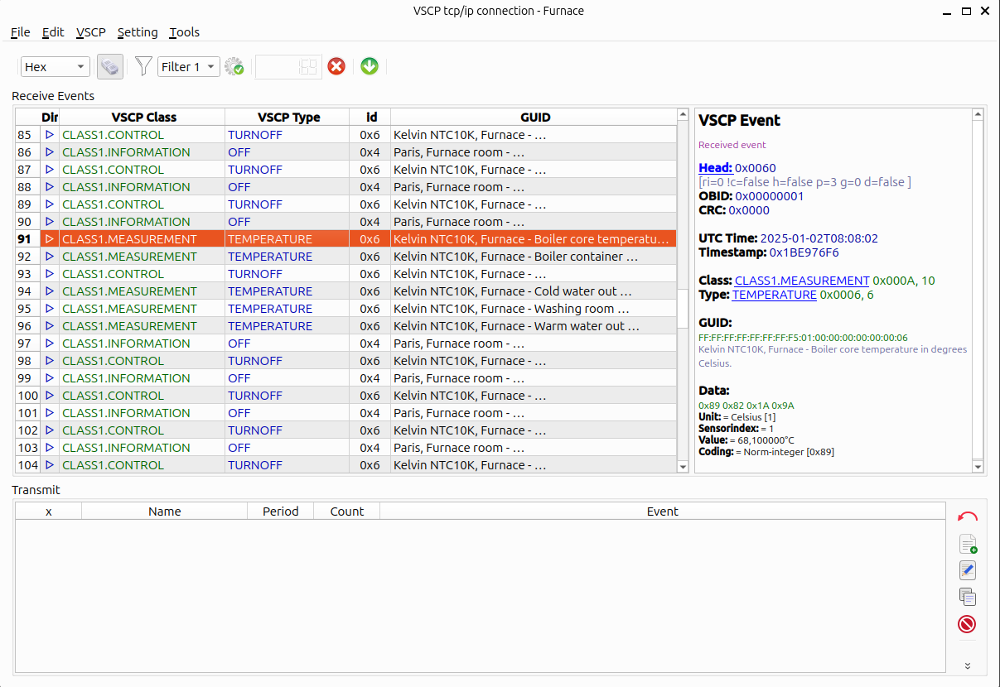

# VSCP Works +

**Describe software version**:${/var/document-version}      
**Doc update:** ${/var/creation-time}       

This is the official documentation for VSCP Works, software that is part of the VSCP & Friends package. VSCP is an IoT framework built mainly for resource-limited devices.

Besides this document, you can read all about VSCP and download it from [the VSCP site](https://www.vscp.org "The VSCP site"). 

**VSCP is free.** Free to use. Free to change. Free to do whatever you want with. VSCP is not owned by anyone, and it will stay free of charge forever.

---

${/var/creation-time}  
This document is licensed under [Creative Commons BY 4.0](https://creativecommons.org/licenses/by/4.0/) and can be freely copied, redistributed, remixed, transformed and built upon, as long as you give credit to the author.

 
