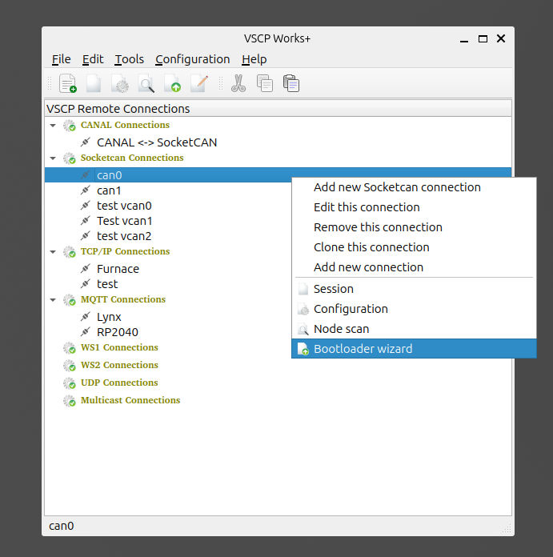
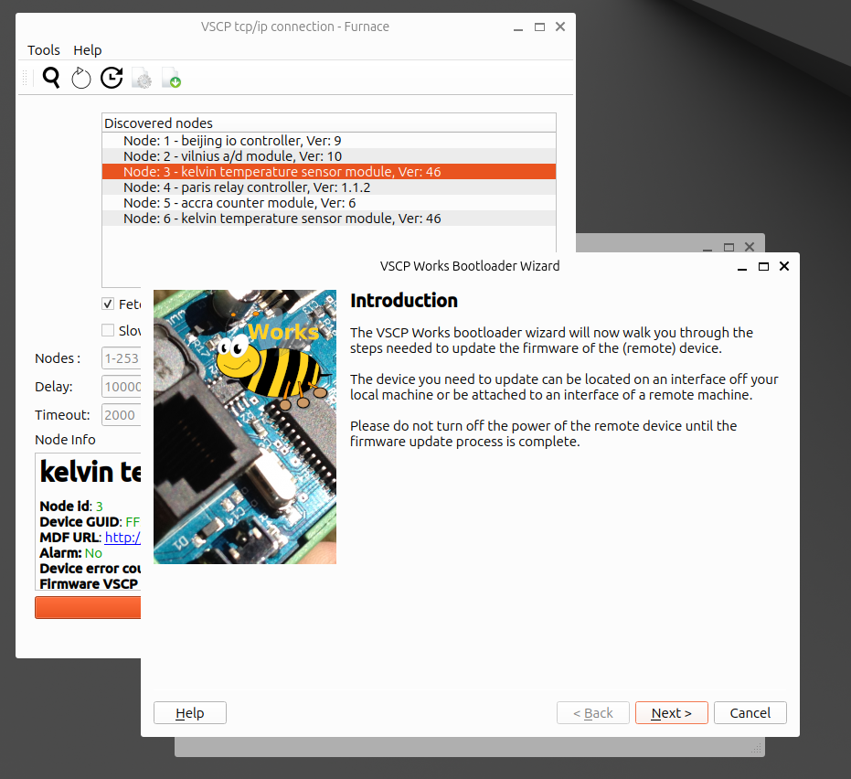
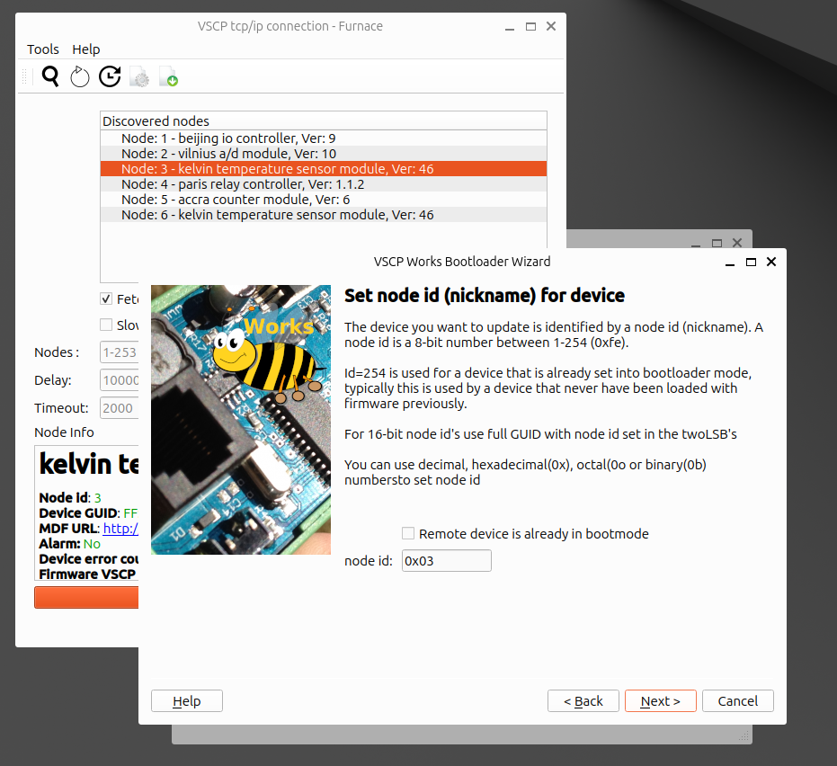
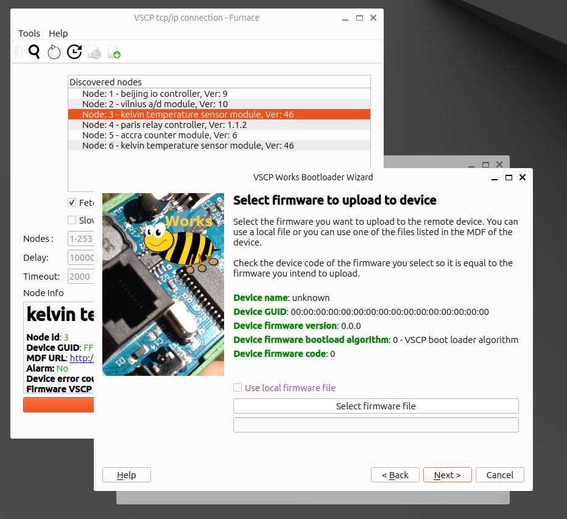
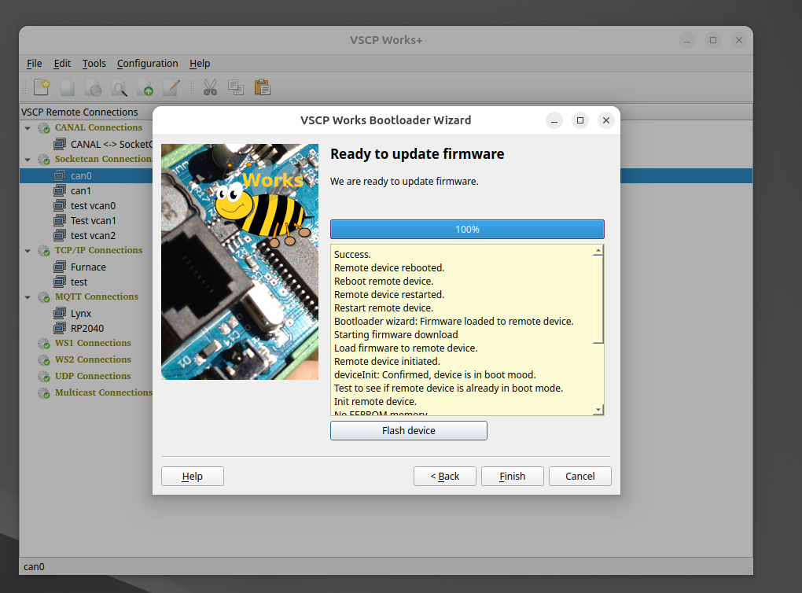

# Loading firmware

## Introduction

Loading and updating firmware on remote hardware is a common task in all kinds of systems. The VSCP bootloader protocol is a generic protocol for loading firmware on a remote device. The code is hardware-independent and can be used on any hardware platform that supports VSCP. Free code is available for both the client side and the device side, on GitHub. This is the standard way to load firmware on VSCP devices.

VSCP also allows manufacturer-specific bootloaders. VSCP Works currently supports bootloaders for the following platforms:

- VSCP bootloader - Works on most systems. Supports Level I and Level II.
- PIC1 - A small bootloader for PIC18F devices on CAN systems. Supports Level I only.

## How to update firmware

Right-click the connection you want to use for the firmware update and select `Bootloader wizard`. As an alternative, you can click the `Bootloader wizard` icon on the toolbar (hover over the icons to see their tooltips), or select the connection and choose `Bootloader wizard...` in the `File` menu.

When you start the wizard this way, you need to know the nickname/node id of the node you want to update. If you don't know it, you can use the [node scan window](scan_window.md) to find it. This is often the easiest way in any case: scan for devices on the connection, right-click the device you want to update and select `Load/update firmware`.

The first step gives some information about the bootload process. Click `Next` to continue.

In the next step you set the `nickname/nodeid or GUID` of the device you want to update. If you started the wizard from the node scan window, it is already filled in.

A new VSCP device straight from production is already in bootloader mode. If this is the case, check the `Remote device is already in boot loader mode` box. The nickname/node id 0xFE is reserved for such new devices.

If the device is not in bootloader mode, check the `Set remote device in boot loader mode` box. VSCP Works then sends a command to the device that puts it in bootloader mode.

Click `Next` to continue.

Next, choose whether to use a local MDF file or to download the MDF that the device points to. For a VSCP node, the normal choice is to use the information from the device. In some cases, such as when developing a new node, a local MDF is the better choice. The MDF provides information about the device and about the firmware that is available for it. The MDF is parsed when you continue.

Click `Next` to continue.

Now select the firmware to load on the device. You can select a local file (`Select local firmware file`) or download the firmware that the MDF points to. The firmware file contains the binary data that will be written to the device. It is parsed when you continue.

The `Device firmware code` is **VERY IMPORTANT**. It is stored in a standard register on a VSCP device and changes whenever the hardware changes in a way that makes older firmware incompatible. The code in the firmware file must be the same as the code in the device register. If it is not, the device may not work properly after the update. **If the codes do not match, do not load the firmware on the device.**

Press `Select firmware file` to select one of the firmware files available for the device. Choose a version that is newer than the one on the device, and again make sure that the `Device firmware code` matches.

Click `Next` to continue.

Press `Flash device` to start the update. It takes some time, and the progress bar shows how far it has come. When the update is done, a message tells you so. If something goes wrong, a message about it is shown in the status area. The device is now ready to use with its new firmware. Press `Finish` to close the wizard.
