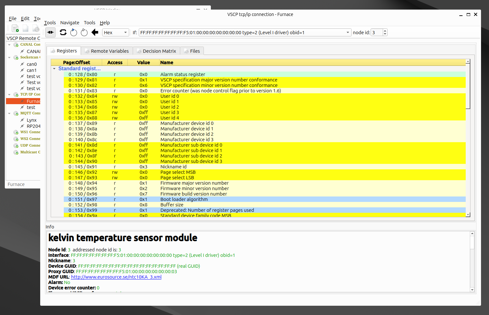

# Configuration window

The configuration window reads and writes the registers of a remote VSCP node and shows them together with the information in the node's Module Description File (MDF). Open it with `File/Configuration...` (`Alt+C`) in the main window, from the context menu of a connection, or with `Configure` in the [node scan window](scan_window.md).

## Selecting the node

The toolbar holds the fields that select the node to configure. Which fields are shown depends on the connection type:

| Field | Description |
| ----- | ----------- |
| node id | Nickname (node id) of a Level I node (CANAL, SocketCAN and other Level I connections). |
| GUID / `Set GUID` | GUID of a Level II node. `Set GUID` selects a GUID from the list of [known GUIDs](settings.md?id=guid). |
| If | Interface on the remote server to use (tcp/ip connections). `---` means none. |

The numerical base used to show values (decimal, hexadecimal, octal or binary) is also selected in the toolbar.

## Reading and writing registers

| Toolbar / `Tools` menu | Description |
| ---------------------- | ----------- |
| `Connect` | Connect to or disconnect from the interface. |
| `Update` | The first time: read all registers and the MDF of the node and show them. After that: write the registers you have changed to the node. |
| `Update Full` | Read everything again: all registers and the MDF. |
| `Update Local` | Same as `Update Full`. |
| `Load registers` / `Save registers` | Load register values from, or save all register values to, a file. |
| `Save selecte register(s)` | Save the values of the selected registers to a file. |
| `Load defaults to all registers` | Set all writable registers to their default values from the MDF. Press `Update` to write them to the node. |
| `Load defaults to selected register(s)` | Set the selected registers to their default values. |

Change a value by editing it in the value column. A changed value is shown in red until it has been written to the node with `Update`; written values are shown in blue.

`Full level II configuration is not implemented yet` is shown if `Update` is used for a node that is configured with full Level II (GUID) addressing.

## Register tree

The `Registers` tab shows the content of the registers, grouped by page, followed by the standard registers. Colors and names come from the MDF; `Tools/Disable colors from MDF` turns the MDF colors off.

Right-click in the register tree for these actions:

| Item | Description |
| ---- | ----------- |
| Update / Full update / Full update with local MDF | Same as the toolbar buttons. |
| Read value(s) for selected row(s) | Read the selected registers from the node again. |
| Write value(s) for selected row(s) | Write the selected registers to the node. |
| Write default value(s) for selected row(s) | Write the MDF default values to the selected registers. |
| Set default values for ALL rows | Set all registers to their default values. |
| Save selected registers / Save ALL registers / Load registers | Save or load register values. |
| Goto register page... | Jump to a register page. |

## Remote variables

The `Remote Variables` tab shows the remote variables defined in the MDF, with their values decoded from the registers they use. Edit a value in the value column and press `Update` to write it. Right-click for:

- `Go to register(s) for this remote variable`
- `Read value(s) for selected row(s)` / `Write value(s) for selected row(s)`
- `Write default value(s) for selected row(s)` / `Set default values for ALL rows`
- `Save register value(s) for selected row(s) to disk` / `Save ALL register values to disk` / `Load register values from disk`

## Decision Matrix

The `Decision Matrix` tab shows the rows of the node's decision matrix (DM). Each row says which event (class, type, origin and zone) triggers which action.

| Action | Key | Description |
| ------ | --- | ----------- |
| Edit row | `Ctrl+E` or double-click | Open the DM row editor. |
| Enable/Disable selected row(s) | `Ctrl+T` | Toggle the enabled state of the selected rows. |
| Go to register position for row | | Show the registers that hold the row. |
| Read selected DM row(s) / Write selected DM row(s) | | Read the rows from, or write them to, the node. |
| Save DM values for selected row(s) to disk / Save DM registers to disk / Load DM values from disk | | Save or load DM values. |

In the row editor you set:

- `Enable row` - the row is active.
- Origin address: `Origin address match` compares the nickname of the sender with the given address, and `Origin address is hardcoded` requires the sender to have a hardcoded address.
- `Match zone` / `Match subzone` - the zone and subzone of the event must match the zone and subzone of the node.
- The class and type filter and mask. `Class Filter Bit 8` and `Class Mask Bit 8` hold the ninth bit of the VSCP class.
- The action and its parameter.

### Actions

The actions a node can perform are listed in its MDF. Select the action for a row in the row editor.

#### Action Parameters

The action parameter is a byte whose meaning is described in the MDF for the action. `Action parameter wizard` in the row editor shows the parameter as described in the MDF and helps you set it.

## Files

The `Files` tab lists the files the MDF refers to: pictures, videos, manuals, firmware, drivers and setup files. Double-click a picture, video or manual to open it.

## Info area

The info area shows information about the selected register, remote variable, decision matrix row or file. If nothing is selected, or if you press `Ctrl+I` (`Tools/Show MDF info`), it shows the MDF information for the remote device.

## Navigate menu

| Item | Key | Description |
| ---- | --- | ----------- |
| Goto register page... | `Alt+P` | Go to a register page. |
| Goto page:register | `Alt+R` | Go to a register given as page:offset. |
| Goto standard registers | `Alt+S` | Go to the standard registers. |
| Goto decsion matrix | `Alt+D` | Go to the registers of the decision matrix. |
| Go to related register | `Alt+.` | Go to the register related to the selected item. |
| Goto register page 0-9 | `Ctrl+0` - `Ctrl+9` | Go to register page 0-9. |
| Search register... / Go to next search register | `F5` / `F6` | Search registers by name and step through the results. |
| Mark all search result registers | | Select all registers found. |
| Search remote variable... / Go to next search remote variable | `F7` / `F8` | Search remote variables and step through the results. |
| Mark all search result remote variables | | Select all remote variables found. |
| Collapse registers | `Alt+-` | Collapse the register tree. |
| Collapse files | `Alt+/` | Collapse the file list. |

The search dialog (`F5`, `F7`) searches the names. Select the type of search (`Exact`, `Contains`, `Start`, `End` or `Regular Expression`), whether it is `Case Sensitive`, and whether all matches are selected (`Mark found`).

## Key shortcuts

| Key | Description |
| --- | ----------- |
| `F1` | Open this page |
| `Ctrl+X` | Close the window |
| `Ctrl+I` | Show MDF info |
| `Ctrl+E` | Edit the selected decision matrix row |
| `Ctrl+T` | Enable/disable the selected decision matrix row(s) |
| `Alt+P`, `Alt+R`, `Alt+S`, `Alt+D`, `Alt+.` | Navigation, see above |
| `Ctrl+0` - `Ctrl+9` | Go to register page 0-9 |
| `F5` - `F8` | Search registers and remote variables |
| `Alt+-`, `Alt+/` | Collapse registers / files |

---

${/var/creation-time}  
This document is licensed under [Creative Commons BY 4.0](https://creativecommons.org/licenses/by/4.0/) and can be freely copied, redistributed, remixed, transformed and built upon, as long as you give credit to the author.
