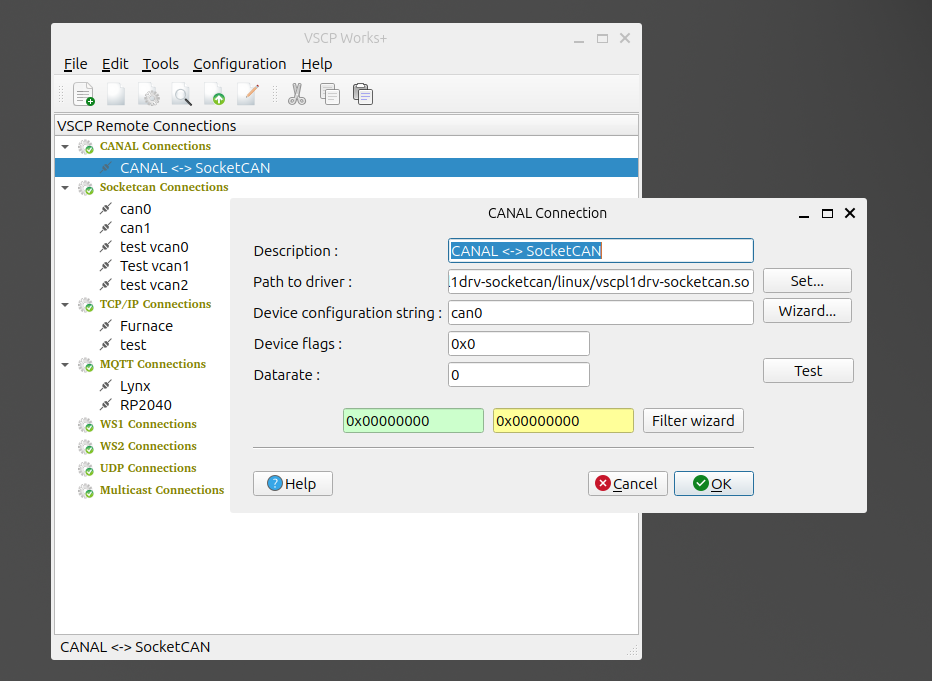
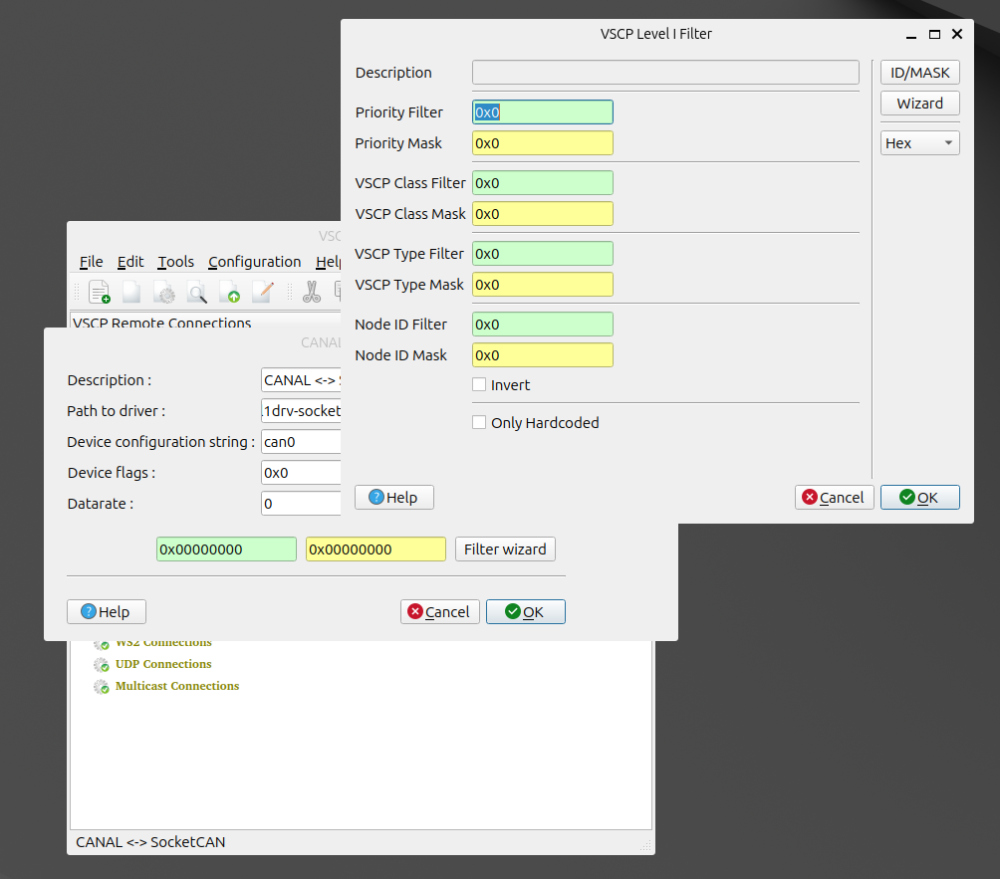
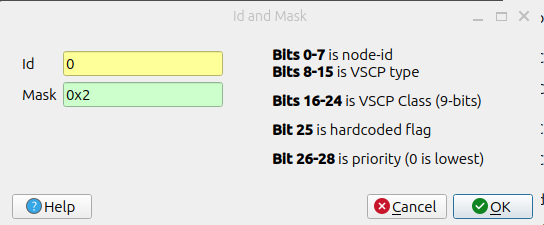
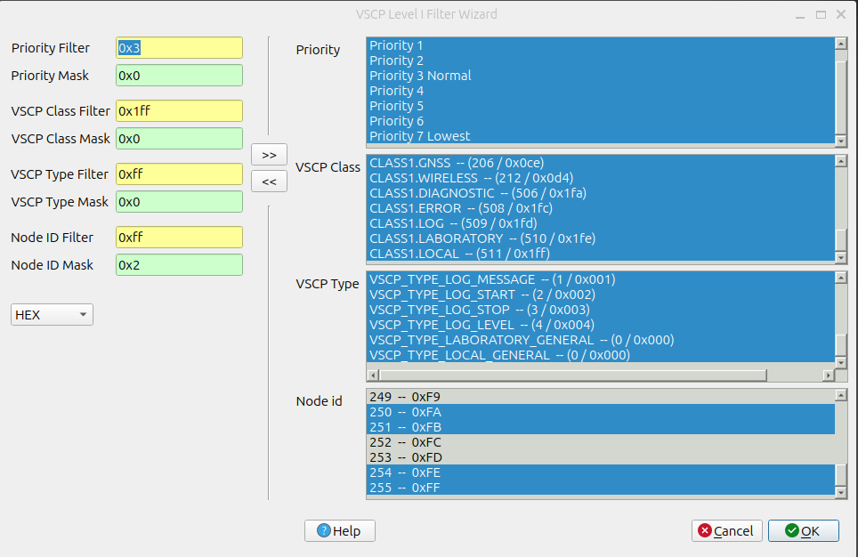

# CANAL

[**CANAL**](https://grodansparadis.github.io/vscp-doc-canal/#/) is the VSCP **CAN** **A**bstraction **L**ayer. It is a VSCP Level I communication method based on CAN frames. A `CANAL driver` is the same as a `VSCP Level I driver`. The driver translates between VSCP events and low-level frames (or a simulation). The frame format and other details are described [here](https://grodansparadis.github.io/vscp-doc-spec/#/./vscp_over_can_can4vscp)

## Add a connection

 - `Description`: A descriptive name. It is used to identify the connection in the tree view.
 - `Path to driver`: The path to the CANAL driver to use. Click `set` to browse for the file. CANAL drivers are the same as `VSCP Level I drivers`. On most Linux systems they are installed in the _/var/lib/vscp/drivers/level1/_ folder by default. On Windows they are usually in the _appdir/VSCP/drivers/level1_ folder. The exact location depends on how the driver was installed.
 - `Device configuration string`: CANAL drivers are configured with a semicolon-separated string. The string is driver-specific and its format is described in the driver documentation. Some modern drivers provide a `wizard` that helps you build the configuration string. Press the `wizard` button to open it.
- `Device flags`: A bit mask used to set driver options. The meaning of the bits is driver-specific and is described in the driver documentation.
- `Datarate`: A device-specific value for the communication rate. It is usually given in bits per second, but the exact meaning is driver-specific; see the driver documentation. In most cases you can leave it at the default value, zero.

### Filter

The filter for a CANAL driver consists of two 32-bit values used to filter out messages you are not interested in: a mask and a filter. If the mask is zero, all messages pass. Otherwise, the mask is ANDed bitwise with the message id, and the message passes only if the result equals the filter.

Truth table for filter/mask:

| Mask bit n | Filter bit n | Incoming event class/type bit n | Accept or reject bit n |
|:------------:|:--------------:|:---------------------------:|:------------------------:|
| 0 | x | x | Accept |
| 1 | 0 | 0 | Accept |
| 1 | 0 | 1 | Reject |
| 1 | 1 | 0 | Reject |
| 1 | 1 | 1 | Accept |

Think of the mask as having ones in the bit positions you care about, and the filter as giving the required value of those bits.

  - To accept only one class, set all class mask bits to one and enter the class in the filter.
  - To accept all classes, set the mask to 0. The filter value then does not matter.

  

The `Filter wizard` makes it easy to build filters for your needs. Press the `wizard` button to open it, enter the class and type you want to filter on, and the wizard builds the filter and mask for you.

Press the `ID/Mask` button to open a dialog where you can enter the filter and mask manually as 32-bit values.

The `wizard` button gives you a view of which events are filtered out and which are not. Select what you are interested in on the right side and move it to the filter value with the `<<` button, or the other way with the `>>` button.

In all of these dialogs you can select the numerical base used to display values. The default is hexadecimal, but you can also use decimal, octal or binary. Numbers can be entered in any base: prefix hexadecimal numbers with `0x`, octal numbers with `0o` and binary numbers with `0b`. Numbers without a prefix are read as decimal.

### Configuration wizard
Some modern drivers provide a `wizard` that helps you build the configuration string. Press the `wizard...` button to open it. It only opens if the driver provides this information. If you are interested in how a CANAL driver supplies information to the wizard, you can read more [here](https://grodansparadis.github.io/vscp-doc-canal/#/canalgetdriverinfo).

## Remove a connection

Right-click the connection in the tree view and select `Remove this connection`. The connection is removed.

## Edit a connection

Right-click the connection in the tree view and select `Edit this connection`. A dialog opens where you can change the connection settings.

## Clone a connection

Right-click the connection in the tree view and select `Clone this connection`. A copy of the connection is added, with ` (copy)` appended to its name. Use `Edit this connection` to change the name and settings of the copy.

## Connect to a remote node

Right-click the connection in the tree view and select the window you want to open (session, configuration, node scan or bootloader wizard). The connection is established from that window.