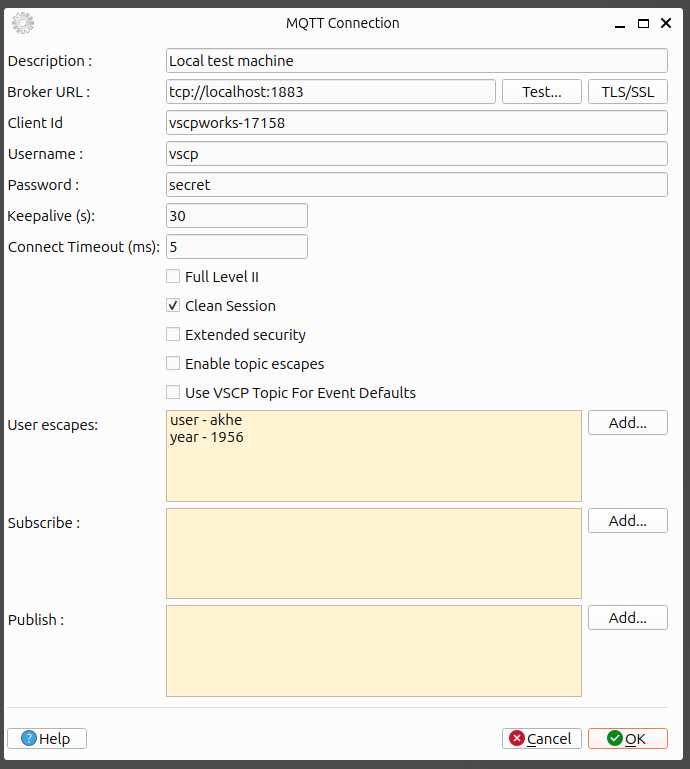
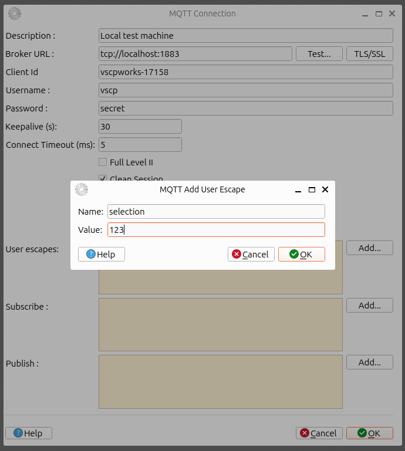
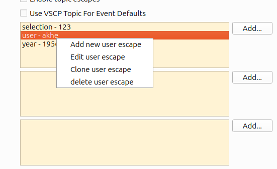
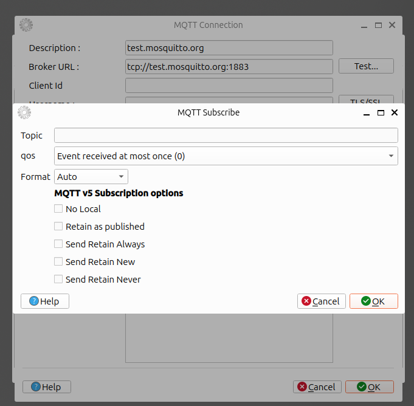
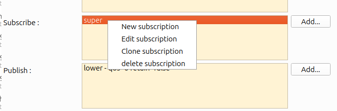
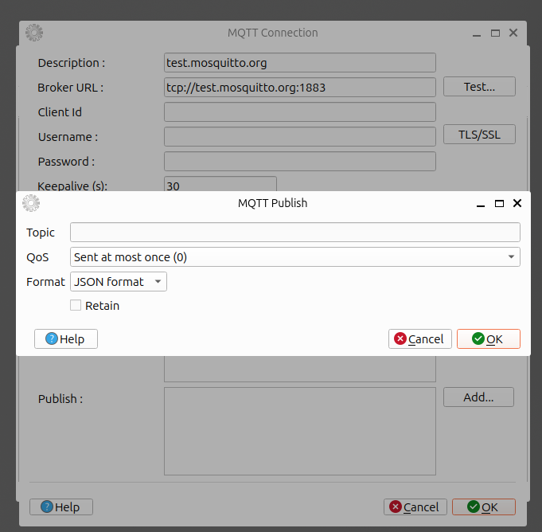
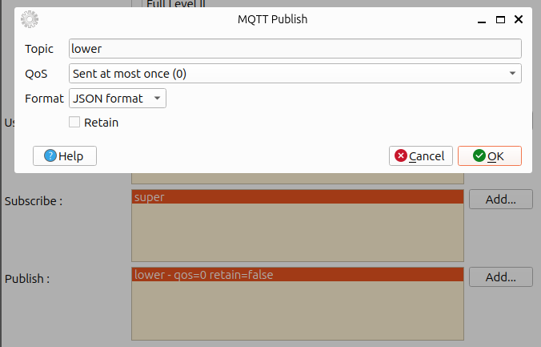
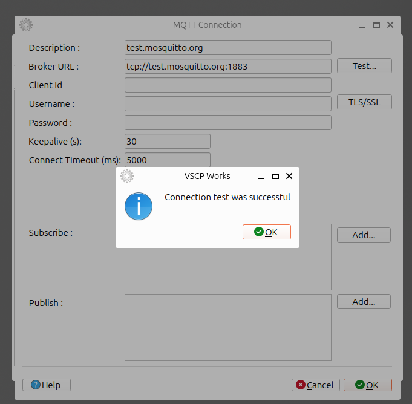
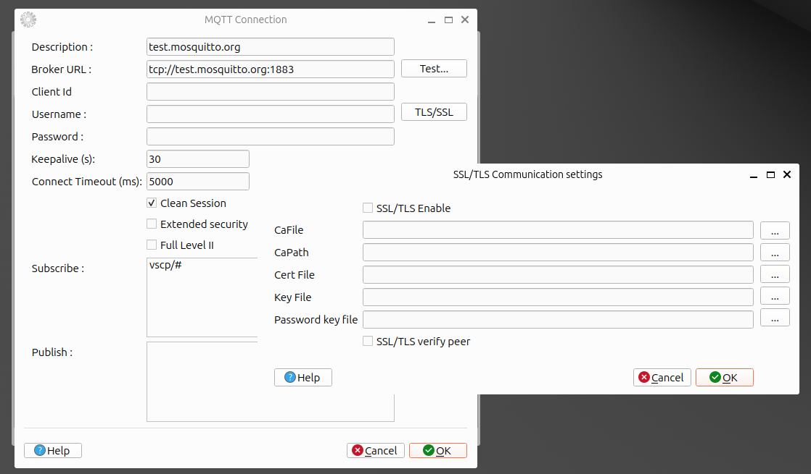

# MQTT

You can read more about [VSCP over MQTT](https://grodansparadis.github.io/vscp-doc-spec/#/./vscp_over_mqtt) in the VSCP specification.

## Add a connection



### Description
A name for the connection. This is the name shown in the connection tree.

### Broker URL
The URL of the MQTT broker. It can be a host name or an IP address, optionally with a port number. If no port is given, the default MQTT port 1883 is used. The URL normally starts with `mqtt://`. If it starts with `mqtts://`, the connection is encrypted with TLS/SSL. You can also use `tcp://` and `stcp://`.

### Client id
The client id used when connecting to the MQTT broker. If it is not set, a random client id is generated.

### Username
The username used when the MQTT broker requires authentication.

### Password
The password used when the MQTT broker requires authentication.

### Keep alive
The number of seconds between keep-alive messages. If no keep-alive message is received within 1.5 times this period, the connection is considered lost.

### Connection timeout
The number of milliseconds to wait for a connection before giving up. The default is 5000 (5 seconds).

### Full Level II
When checked, the connection uses the full VSCP Level II protocol and the full GUID to identify remote nodes.

### Clean session
When checked, the connection uses a clean session. This means the broker does not store messages for the client while it is offline.

### Extended security
When checked, the connection uses extended security, which means it is encrypted and authenticated.

### Enable topic escapes
Check this box to enable mustache escapes in topic strings. This powerful feature lets you use the same mustache escapes in topics as the VSCP daemon does. More information is [here](https://grodansparadis.github.io/vscp/#/publishing_server?id=publishing-server-topic-escapes). This also enables the `user escapes` described below.

### Use VSCP Topic For Event Defaults
When checked, the connection takes default event values from the VSCP topic. This means the GUID, class and type are taken from the topic if some or all of them are zero in the event. The topic must use the _standard_ VSCP MQTT topic format

```bash
vscp/<guid>/<class>/<type>
```
This makes it possible to send events over MQTT with very little overhead. More information is [here](https://grodansparadis.github.io/vscp-doc-spec/#/./vscp_over_mqtt?id=minimize-transfer-load)

### User escapes



Add `user escapes` by clicking the add button next to the user escapes list. A user escape is a pair of a name and a value. The name can be used in publish topics as a mustache item, for example `{{name}}`, and is replaced by the value at runtime.



Right-click the list to add, edit, clone or delete user escapes.

### Subscriptions



Enter the topics you want to subscribe to here. You can add as many as you like. The topic format for a channel from a VSCP node is typically

```bash
vscp/<guid>/<class>/<type>/<nickname>/<sensor-index>/<zone>/<subzone>
```
where nickname is the least significant bytes of the GUID, and sensor-index, zone and subzone are optional. To subscribe to all events from a node, use

```bash
vscp/<guid>/#
```

To subscribe to all events from all nodes, use

```bash
vscp/#
```

You can also use wildcards in the topic, for example

```bash
vscp/<guid>/<class>/<type>/+/<sensor-index>/#
```

which subscribes to events of a specific class/type from a specific sensor index on any node.




Right-click the list to add, edit, clone or delete subscribe topics.

For each subscription you set the topic, the QoS and the payload format (`Auto` detects it). For MQTT v5 brokers these subscription options can also be set:

| Option | Description |
| ------ | ----------- |
| No Local | The broker does not send back messages that this client publishes to a topic it is subscribed to. |
| Retain as published | Messages keep the retain flag that the publishing client set. Without it, the retain flag tells whether a message is fresh or stale. |
| Send Retain Always | Retained messages are sent when the subscription is made, even if the subscription already exists. This is the default. |
| Send Retain New | Retained messages are sent only when the subscription does not already exist. |
| Send Retain Never | Retained messages are never sent for this subscription. |

### Publishing



Just as for subscriptions, you can add as many publish topics as you like. The topic format for a channel from a VSCP node is typically

```text 
vscp/<guid>/<class>/<type>/<nickname>/<sensor-index>/<zone>/<subzone>
```
where nickname is the two least significant bytes of the GUID, and sensor-index, zone and subzone are optional.

Topics can use the same [mustache escapes](https://en.wikipedia.org/wiki/Mustache_(template_system)) as the VSCP daemon, which are described [here](https://grodansparadis.github.io/vscp/#/publishing_server?id=publishing-server-topic-escapes). For example, you can insert the GUID of the current event with the escape `{{guid}}`. A topic in the standard VSCP form can therefore be written as

```mustache
vscp/{{guid}}/{{class}}/{{type}}/{{nickname}}
```

`Enable topic escapes` must be checked for mustache escapes to work.



Right-click the list to add, edit, clone or delete publish topics.

### Test connection


### Filter
`Filter...` sets a filter for incoming events on priority, class, type and GUID, in the same way as for a [tcp/ip connection](connection_tcpip.md?id=filters). Events that do not pass it are dropped by the connection.

### TLS/SSL



Security settings for the connection. To use TLS/SSL, you must set the parameters here. The fields are described in [tcp/ip SSL/TLS](connection_tcpip.md?id=ssltls).

## Remove a connection

Right-click the connection in the tree view and select `Remove this connection`. The connection is removed.

## Edit a connection

Right-click the connection in the tree view and select `Edit this connection`. A dialog opens where you can change the connection settings.

## Clone a connection

Right-click the connection in the tree view and select `Clone this connection`. A copy of the connection is added, with ` (copy)` appended to its name. Use `Edit this connection` to change the name and settings of the copy.

## Connect to a remote node

Right-click the connection in the tree view and select the window you want to open (session, configuration, node scan or bootloader wizard). The connection is established from that window.