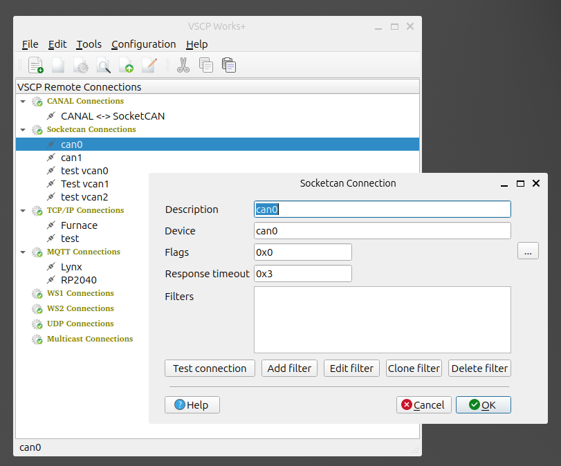
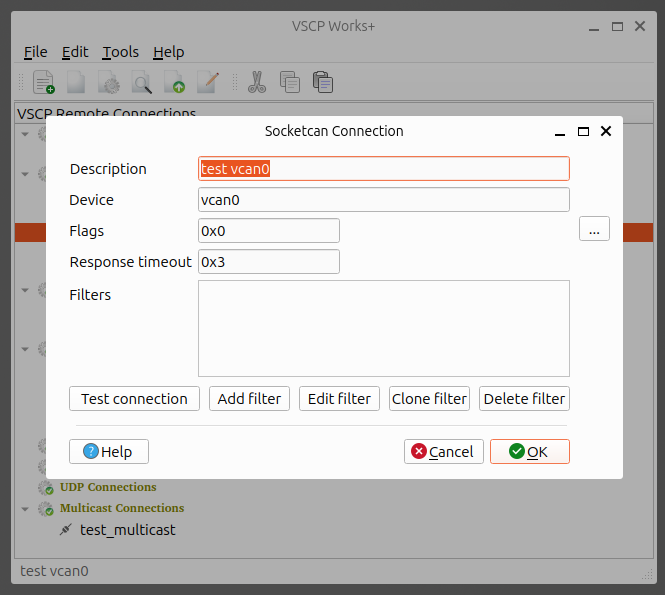
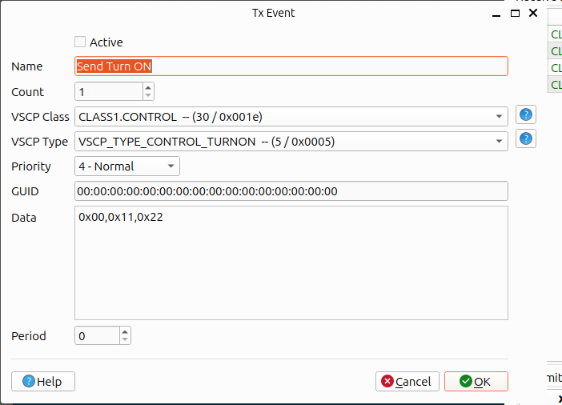
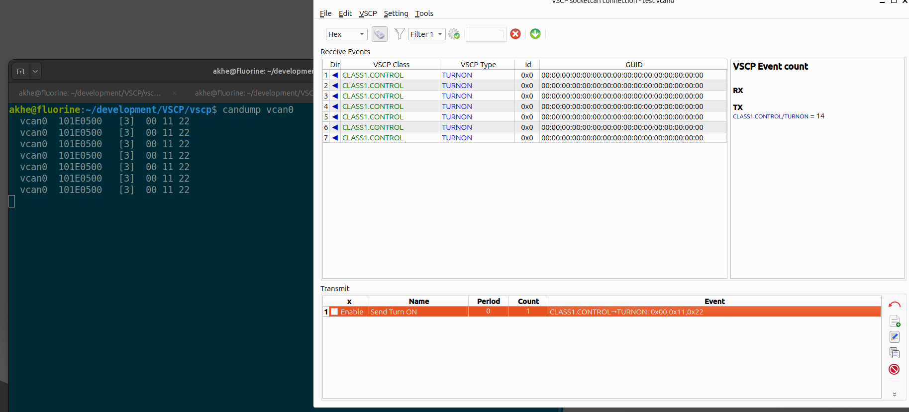
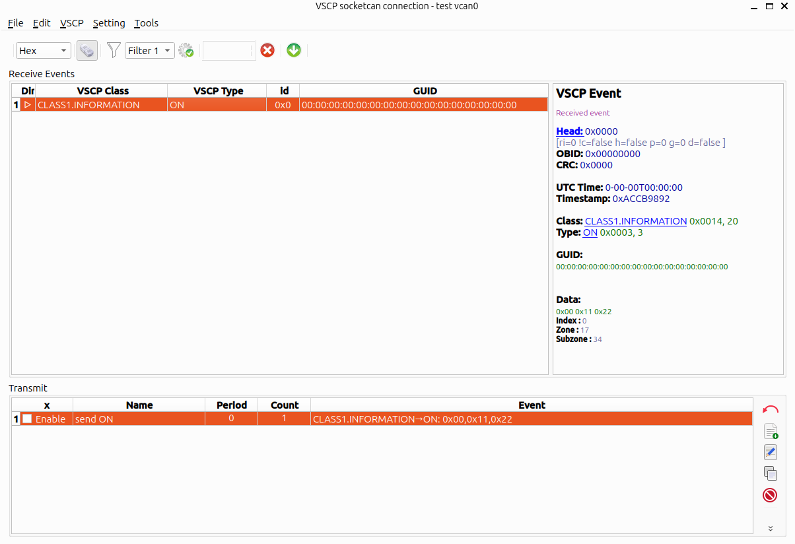

# Socketcan

You can read more about [VSCP over SocketCAN](https://grodansparadis.github.io/vscp-doc-spec/#/./vscp_over_can_can4vscp) in the VSCP specification. The Linux kernel supports the CAN bus through the `socketcan` interface. Like CANAL, this is a VSCP Level I communication method based on CAN frames.

SocketCAN is only available on Linux.

## Add a connection

Right-click the `Socketcan` item in the tree view and select `Add new Socketcan connection...`. A dialog opens where you enter the connection settings.



 - `Description`: A descriptive name. It is used to identify the connection in the tree view.
 - `Device`: The name of the CAN interface, usually something like `can0` or `can1`. The exact name depends on the system. You can find the available names in the `/sys/class/net/` folder.
 - `Flags`: SocketCAN flags used to set special options for the CAN interface. Press the `...` button to open a dialog where you can set them.
 - `Response timeout`: The time in milliseconds to wait for a response from a device. If no response is received in time, the operation is aborted.
 - `Filters`: Any number of filters for the CAN interface. Each filter is a 32-bit filter/mask pair used to filter out messages you are not interested in. A message passes a filter if its id ANDed with the mask equals the filter ANDed with the mask, so a mask of zero passes everything. With `Invert` set, a filter passes the messages that do not match. A message is received if it passes any of the filters; with no filters all messages are received. The filters are set on the CAN socket, so the kernel drops the other messages.

### Test button
Press the `Test connection` button to check that your SocketCAN settings work.

### Filters
Use the `Add filter` button to add a filter, `Edit filter` to edit the selected filter, `Clone filter` to clone the selected filter and `Delete filter` to remove the selected filter.

- Click a filter item to select it.
- Double-click a filter item to edit it.
- Right-click a filter item to get a menu where you can edit, clone or delete the filter.

See [CANAL filters](connection_canal.md?id=filter) for more information about filters.

## Remove a connection

Right-click the connection in the tree view and select `Remove this connection`. The connection is removed.

## Edit a connection

Right-click the connection in the tree view and select `Edit this connection`. A dialog opens where you can change the connection settings.

## Clone a connection

Right-click the connection in the tree view and select `Clone this connection`. A copy of the connection is added, with ` (copy)` appended to its name. Use `Edit this connection` to change the name and settings of the copy.

## Connect to a remote node

Right-click the connection in the tree view and select the window you want to open (session, configuration, node scan or bootloader wizard). The connection is established from that window.

## Open a raw CAN frame session

For SocketCAN connections there is also a dedicated frame window, available from the connection's right-click menu as **CAN raw explorer**. It can send and receive both standard CAN and CAN FD frames. Press `Connect` in the window to open the interface.

The payload field accepts hex bytes (`11 22 33` or `112233`) or comma-separated byte values, where `0x` means hexadecimal, `0o` octal, `0b` binary and values without a prefix are decimal, for example `0x11,0o10,0b11,4`.

The frame log is color-coded to make traffic easier to read: TX and RX rows use different colors, and the frame type/flags cell is highlighted for Remote, FD, BRS and ESI frames.

See [CAN raw explorer](rawcan_window.md) for details.

## Testing

If you have can-utils installed, you can use the `cansend` and `candump` utilities to test the SocketCAN support in VSCP Works. Install can-utils with the following commands

```bash
sudo apt update
sudo apt upgrade
sudo apt install can-utils
```

on a Debian-based system such as Ubuntu. On other systems, use the system's package manager to install can-utils, or build it from source.

Next, set up a virtual CAN interface with the following commands.

```bash
# Virtual i/f 0
sudo ip link add dev vcan0 type vcan
sudo ip link set up vcan0 mtu 72
```
This creates a virtual CAN interface, `vcan0`, that you can use to test the SocketCAN support in VSCP Works. Setting the MTU to 72 in the last line puts the interface in CAN FD mode; this is optional.

You can create as many virtual CAN interfaces as you like.

Bring up the interface with

```bash
sudo ip link set vcan0 up
```

When you are done with the interface, you can take it down with

```bash
sudo ip link set vcan0 down
``` 

but leave it up for now.

### Listen to events sent from VSCP Works

Open a terminal and type

```bash
candump vcan0
``` 

This shows all frames sent on the `vcan0` interface.

Now add a new SocketCAN connection in VSCP Works+ like this



Open a session window for it and define a transmit event like this one



It will look something like this



The usual positive response to a [CLASS1.CONTROL, VSCP_TYPE_TURN_ON](https://grodansparadis.github.io/vscp-doc-spec/#/./class1.control?id=type5) event is a [CLASS1.INFORMATION, VSCP_TYPE_INFORMATION_ON](https://grodansparadis.github.io/vscp-doc-spec/#/./class1.information?id=type3) event. You can send one with cansend (for example in a new terminal window) like this

```bash
cansend vcan0 10140300#001122
```

This will send a [CLASS1.INFORMATION, VSCP_TYPE_INFORMATION_ON](https://grodansparadis.github.io/vscp-doc-spec/#/./class1.information?id=type3) event on the `vcan0` interface. You should see the event both in the terminal where `candump vcan0` is running and in the VSCP Works+ session window.



The SocketCAN representation may look strange at first, but it is simply how VSCP packs events into CAN frames. You can read more about this [here](https://grodansparadis.github.io/vscp-doc-spec/#/./vscp_over_can_can4vscp).
