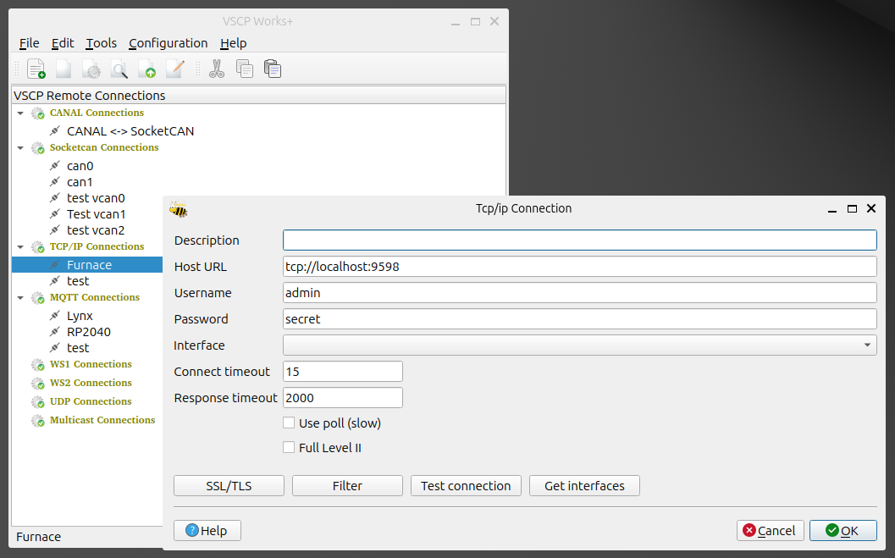
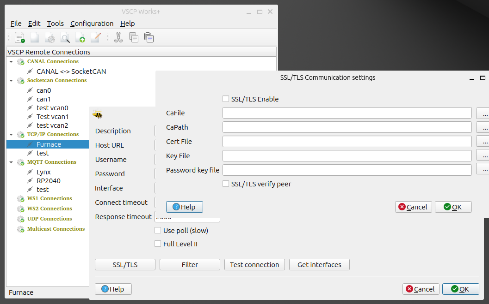
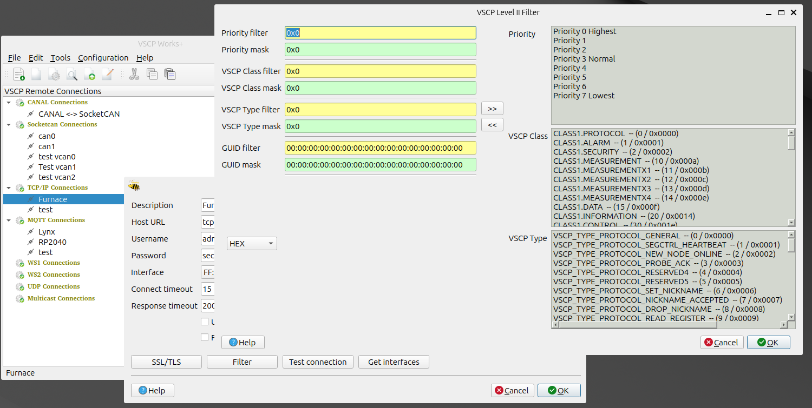
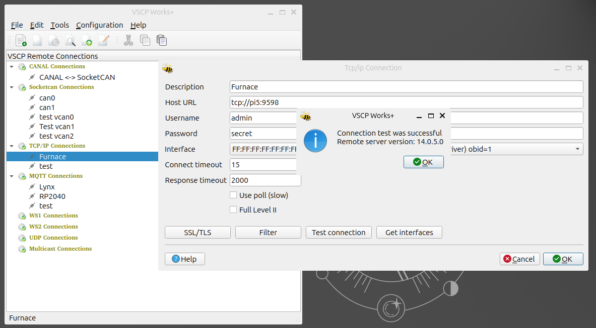
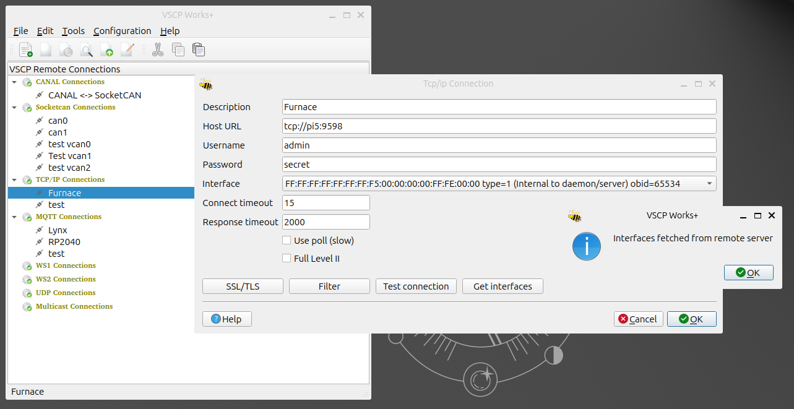

# tcp/ip

You can read more about the [VSCP tcp/ip link protocol](https://grodansparadis.github.io/vscp-doc-spec/#/./vscp_over_tcp_ip) in the VSCP Specification.

## Add a connection

### SSL/TLS

### Filters

### Test connection

### Get Interfaces

## Remove a connection

Right-click the connection in the tree view and select `Remove this connection`. The connection is removed.

## Edit a connection

Right-click the connection in the tree view and select `Edit this connection`. A dialog opens where you can change the connection settings.

## Clone a connection

Right-click the connection in the tree view and select `Clone this connection`. A copy of the connection is added, with ` (copy)` appended to its name. Use `Edit this connection` to change the name and settings of the copy.

## Connect to a remote node

Right-click the connection in the tree view and select the window you want to open (session, configuration, node scan or bootloader wizard). The connection is established from that window.

