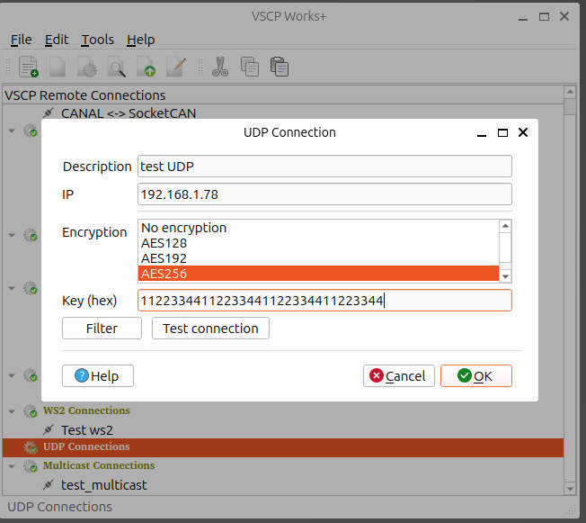

# UDP

You can read more about [VSCP over UDP](https://grodansparadis.github.io/vscp-doc-spec/#/./vscp_over_udp) in the VSCP specification.

## Add a connection

### Encryption and authentication

| Field | Value |
| ----- | ----- |
| Encryption | `No encryption`, `AES128`, `AES192` or `AES256` |
| Key (hex) | Exactly 32, 48 or 64 hex characters for AES128, AES192 or AES256. Leave blank to use the built in default key, which is not secure. |
| HMAC key (hex) | Optional. 64 hex characters (32 bytes). When set, frames are authenticated encrypted (AES + HMAC-SHA-256) and frames that fail authentication are dropped. Needs an AES algorithm and an explicitly set key that is different from the HMAC key. |
| Require encryption | Drop received frames that are not encrypted with the selected algorithm. Needs an AES algorithm and an explicitly set key. |

All nodes that communicate must use the same algorithm and keys. The settings are checked when you press `OK` or `Test connection`.

## Remove a connection

Right-click the connection in the tree view and select `Remove this connection`. The connection is removed.

## Edit a connection

Right-click the connection in the tree view and select `Edit this connection`. A dialog opens where you can change the connection settings.

## Clone a connection

Right-click the connection in the tree view and select `Clone this connection`. A copy of the connection is added, with ` (copy)` appended to its name. Use `Edit this connection` to change the name and settings of the copy.

## Connect to a remote node

Right-click the connection in the tree view and select the window you want to open (session, configuration, node scan or bootloader wizard). The connection is established from that window.