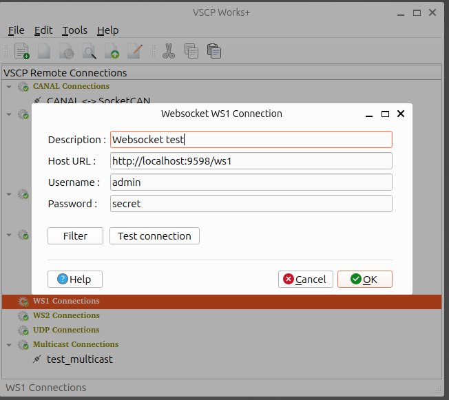

# ws1

You can read more about the string-based VSCP websocket protocol [ws1](https://grodansparadis.github.io/vscp-doc-spec/#/./vscp_websocket?id=ws1-description) in the VSCP specification. 

## Add a connection

The ws1 connection works with the VSCP websocket server ([vscpl2drv-websocksrv](https://github.com/grodansparadis/vscpl2drv-websocksrv)).

| Setting | Description |
| ------- | ----------- |
| Description | Name of the connection. |
| Host URL | Address of the server, `ws://host:port/ws1`. The server listens on port 8884 by default. Use `wss://` for an encrypted (TLS) connection. If the path is left out, `/ws1` is used. |
| Username / Password | A user defined on the server. |
| Key (hex) | The AES-128 key the server uses to decrypt the user name and password (the file set with `key-file` in the server configuration), 32 hexadecimal characters. Leave it empty to use the default sample key, which the server also uses when it has no key file. Use your own key on any server that can be reached by others. |
| Connect timeout | Milliseconds to wait for the connection, the TLS handshake and the login. |
| Response timeout | Milliseconds to wait for the reply to a command. |

`Filter...` sets a receive filter. It is sent to the server, so filtered events never cross the network, and it is also checked by VSCP Works, so it works for users that are not allowed to set a filter on the server.

`TLS...` holds the settings for `wss://` connections: whether the server certificate is verified, CA certificates (file or directory, the system certificates are used when none is given), and an optional client certificate and key. Turning TLS on or off in this dialog changes the URL between `ws://` and `wss://`.

`Test connection` connects, logs in and asks the server for its protocol version.

The password, the key and the client key password are stored in the keyring of the operating system, see [Passwords and keys](./passwords_and_keys).

## Remove a connection

Right-click the connection in the tree view and select `Remove this connection`. The connection is removed.

## Edit a connection

Right-click the connection in the tree view and select `Edit this connection`. A dialog opens where you can change the connection settings.

## Clone a connection

Right-click the connection in the tree view and select `Clone this connection`. A copy of the connection is added, with ` (copy)` appended to its name. Use `Edit this connection` to change the name and settings of the copy.

## Connect to a remote node

Right-click the connection in the tree view and select the window you want to open (session, configuration, node scan or bootloader wizard). The connection is established from that window.

