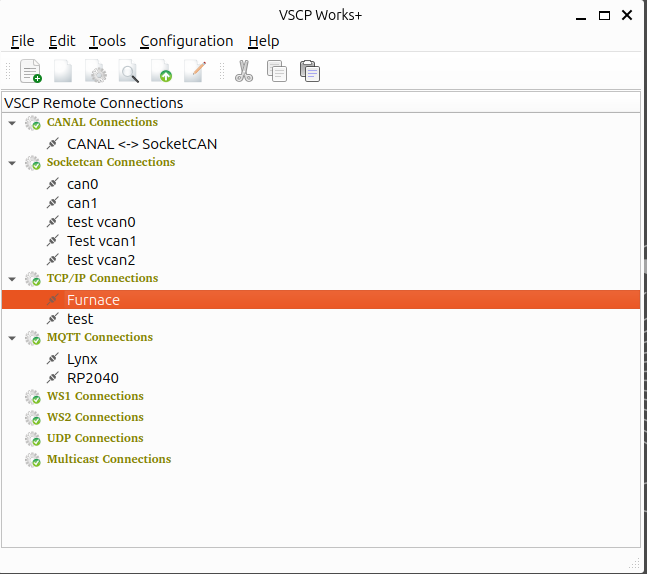

# Introduction

The main window of VSCP Works has a tree view listing all available communication types. This is where you add, remove and configure connections to your remote hardware devices. Normally you right-click in the tree view and select the operation you want. You can also use the `File` menu or the toolbar for the same tasks. In most cases it is fine to have several windows open at the same time for the same connection.

# Communication types/protocols

VSCP Works can communicate with many different hardware devices using a range of communication protocols. The following protocols are currently supported:

  * [CANAL](./connection_canal)
  * [Socketcan](./connection_socketcan)
  * [tcp/ip](./connection_tcpip)
  * [MQTT](./connection_mqtt)
  * [WS1](./connection_ws1)
  * [WS2](./connection_ws2)
  * [UDP](./connection_udp)
  * [Multicast](./connection_multicast)
  * [Level II driver](./connection_level2)

In addition, there are two groups of *raw* connections that are not limited to VSCP traffic:

  * **Raw CAN Connections** - A SocketCAN device used by the [CAN raw explorer](rawcan_window.md) to look at and send plain CAN/CAN FD frames (Linux only).
  * **Raw MQTT Connections** - An MQTT broker used by the [MQTT raw explorer](mqtt_explorer_window.md) to look at and publish any MQTT traffic.

The table below gives a short description of each protocol. Click a protocol name for more information.

| Protocol | Description |
|----------|-------------|
| [**CANAL**](https://grodansparadis.github.io/vscp-doc-canal/#/) | The VSCP **CAN** **A**bstraction **L**ayer. A VSCP Level I communication method based on CAN frames. A `CANAL driver` is the same as a `VSCP Level I driver`; it translates between VSCP events and low-level frames (or a simulation). The frame format and other details are described [here](https://grodansparadis.github.io/vscp-doc-spec/#/./vscp_over_can_can4vscp). |
| [**Socketcan**](https://grodansparadis.github.io/vscp-doc-spec/#/./vscp_over_can_can4vscp) | The Linux kernel supports the CAN bus through the `socketcan` interface. This is also a VSCP Level I communication method based on CAN frames. Only available on Linux. |
| [**tcp/ip**](https://grodansparadis.github.io/vscp-doc-spec/#/./vscp_over_tcp_ip) | The VSCP tcp/ip link protocol. |
| [**MQTT**](https://grodansparadis.github.io/vscp-doc-spec/#/./vscp_over_mqtt) | VSCP over MQTT.  |
| [ws1](https://grodansparadis.github.io/vscp-doc-spec/#/./vscp_websocket?id=ws1-description) | A string-based VSCP websocket protocol. |
| [ws2](https://grodansparadis.github.io/vscp-doc-spec/#/./vscp_websocket?id=ws2-description) | A JSON-based VSCP websocket protocol. |
| [UDP](https://grodansparadis.github.io/vscp-doc-spec/#/./vscp_over_udp) | The connectionless VSCP UDP protocol. |
| [Multicast](https://grodansparadis.github.io/vscp-doc-spec/#/./vscp_over_multicast?id=vscp-multicast) | VSCP multicast.  |
| [Level II driver](./connection_level2) | Loads a VSCP Level II driver (`vscpl2drv-*`) directly, with its configuration in a file or embedded in the connection. |

# Remove a connection

Right-click the connection in the tree view and select `Remove this connection`. The connection is removed.

# Edit a connection

Right-click the connection in the tree view and select `Edit this connection`. A dialog opens where you can change the connection settings.

# Connect to a connection

Right-click the connection in the tree view and select the window you want to open (session, configuration, node scan or bootloader wizard). The connection is established from that window.

# Connection context menu

Right-clicking a connection in the tree view gives the following options:

| Item | Description |
| ---- | ----------- |
| Add new ... connection | Add a new connection of the same type. |
| Edit this connection | Edit the connection settings. |
| Remove this connection | Remove the connection. |
| Clone this connection | Make a copy of the connection. The copy gets the same settings, a new identity and ` (copy)` appended to its name. Useful when you need several similar connections. |
| Copy session data to clipboard | Copy the connection definition (JSON) to the clipboard. |
| Save session data to file | Save the connection definition to a JSON file. |
| Add new connection | Add a new connection of any type. |
| Session | Open a [session window](session_window.md). |
| CAN raw explorer | Open a [CAN raw explorer](rawcan_window.md) using the device of the connection (Socketcan connections only). |
| MQTT raw explorer | Open an [MQTT raw explorer](mqtt_explorer_window.md) using the broker of the connection (MQTT connections only). |
| Configuration | Open a [configuration window](config_window.md). |
| Node scan | Open a [node scan window](scan_window.md). |
| Bootloader wizard | Start the [bootloader wizard](bootload_window.md). |

# Import and export of connections

You can move connection definitions between computers or share them with others.

**Export** - Right-click a connection and select `Copy session data to clipboard` or `Save session data to file`. The connection definition is exported as JSON.

**Import** - Use `Edit/Import session data/From clipboard...` or `Edit/Import session data/From file...` in the main window, or `Import from clipboard`/`Import from file` in the new connection dialog. The following formats are accepted:

- A single connection definition in JSON or XML format.
- A JSON object with the connection in a `connection` member, for example a session file exported from a [session window](session_window.md?id=sessions).
- A JSON object with a `connections` array, or a JSON array, holding exactly one connection.

The connection type may be given as a number or as a name (for example `tcpip`). After import, the settings dialog for the connection type is opened with the imported values so you can review them before the connection is added.

# Filter

Filters for incoming events can be set for most connection types in the connection settings dialog. Session filters, that work on the events shown in a session window, are described [here](session_window.md?id=filters).

