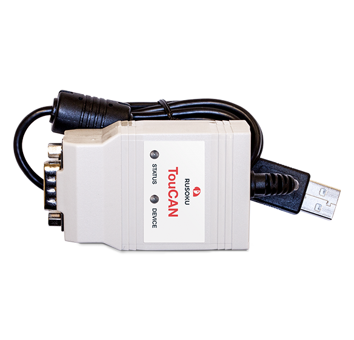
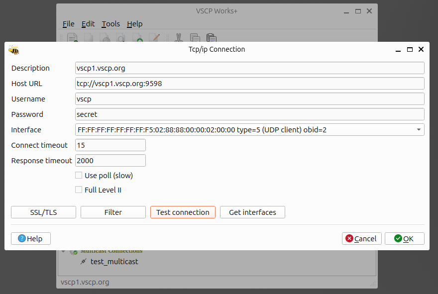
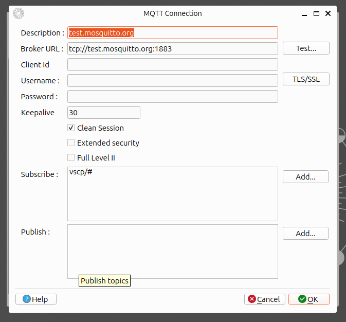

# Demo 

There are some demo sources you can use to get started with VSCP Works +. The demo data is described in the [VSCP wiki](https://github.com/grodansparadis/vscp/wiki/Demo). The current demo publishes real-time events from a number of nodes in the house where our office is located.

The sections below describe how to connect to these sources with VSCP Works +.

## CANAL


To test CANAL you must install a CANAL driver. We recommend the [TouCAN CAN adapter](https://www.rusoku.com/products) as a good starting point. You can find its CANAL driver in the download section of the Rusoku website. The TouCAN can also be used on Linux and macOS.

## SocketCAN
Download and install the [VSCP Simulator](https://github.com/grodansparadis/vscp-simulator). It lets you simulate fully functional Level I and Level II nodes.

Another option is to use a virtual CAN interface. You can read more about this [here](connection_socketcan?id=testing).

If you are serious about using SocketCAN, you will need a CAN adapter that supports it, such as the TouCAN described above.


## tcp/ip


Create a new tcp/ip connection with the settings shown above and you will receive a stream of VSCP events generated in this house. The meaning of each event is described in the wiki.

## MQTT


Create a new MQTT connection with the settings shown above and you will receive a stream of VSCP events generated in this house. The meaning of each event is described in the wiki.

As an alternative, you can use mqtt.vscp.org as the broker with **user**: _"vscp"_ and **password**: _"secret"_.

## Demo GUID and sensor database

[Here](https://vscp.org/vscpworks/vscpworks.sqlite3) is a demo database with GUIDs and sensor indexes for the nodes that publish events. On Linux, copy this file to

```bash
~/.local/share/VSCP/vscp-works/qt
```

and on Windows, copy it to

```bash
C:\Users\<<<your user name>>>\AppData\Local\vscp-works-qt/
```

When you now start VSCP Works + and connect to one of the sources above, the session window will show symbolic GUID names and sensor information.
