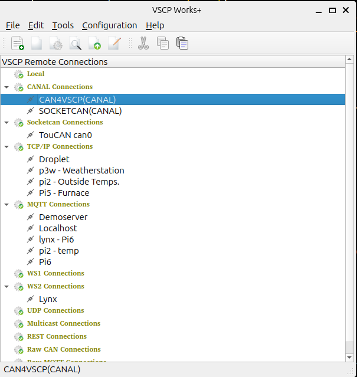

# Main window

The main window holds the connection tree, where all defined connections are listed grouped by type (see [connections](connections.md)), and the menus and toolbar used to open the other windows of VSCP Works +. Press `F1` to open the help for connections.

## File menu and toolbar

| Item | Description |
| ---- | ----------- |
| New connection... | Add a new connection. You select the connection type, or import a saved connection, in the dialog that opens. |
| Session window... | Open a [session window](session_window.md) for the selected connection. |
| Configuration... | Open a [configuration window](config_window.md) for the selected connection. |
| Scan for nodes... | Open a [node scan window](scan_window.md) for the selected connection. |
| Bootloader wizard... | Start the [bootloader wizard](bootload_window.md) for the selected connection. |
| MDF editor... | Open the [MDF editor](mdf.md). |
| MQTT raw explorer window... | Open the [MQTT raw explorer](mqtt_explorer_window.md). |
| SocketCAN frame session... | Open the [CAN raw explorer](rawcan_window.md) (not on Windows). |
| Exit | Exit the program. |

## Edit menu

| Item | Description |
| ---- | ----------- |
| Cut / Copy / Paste | Standard clipboard operations. |
| Import session data/From clipboard... | Import a connection definition from the clipboard. See [import and export of connections](connections.md?id=import-and-export-of-connections). |
| Import session data/From file... | Import a connection definition from a JSON or XML file. |
| Settings... | Open the [settings](settings.md) dialog. |

## Tools menu

| Item | Description |
| ---- | ----------- |
| Known GUID's | Give GUIDs symbolic names and define sensor names. See [GUID](settings.md?id=guid). |
| Session filters... | Define session filters. See [filters](session_window.md?id=filters). |

## Tests menu

| Item | Description |
| ---- | ----------- |
| VSCP Link protocol test tool... | Open the [VSCP Link protocol test tool](linktest_window.md) used to verify tcp/ip link protocol servers. |

## Help menu

| Item | Description |
| ---- | ----------- |
| Check for updates... | Check if a newer version of VSCP Works + is available. You are told if there is a new version. |
| View Log... | Open the [log viewer](logging.md?id=log-viewer). |
| About | Version and license information. |
| About Qt | Information about the Qt version used. |
