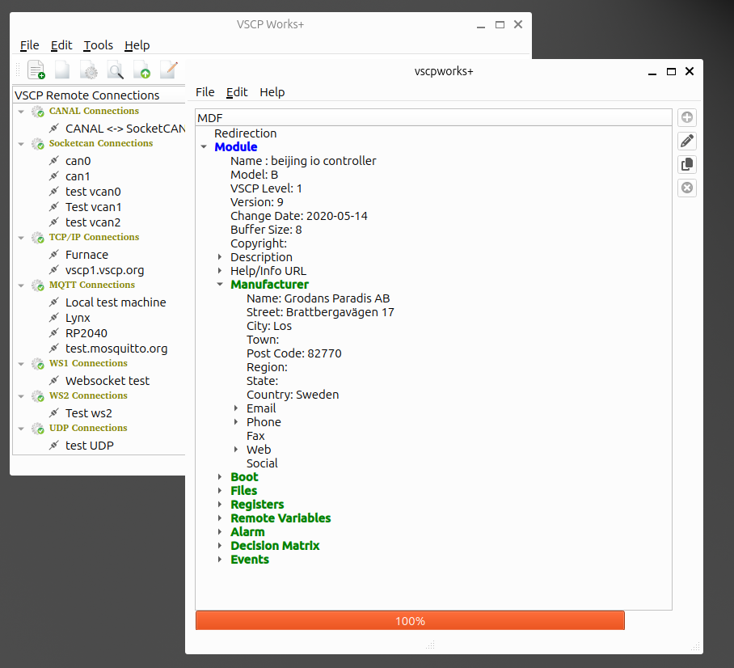

# MDF

The **M**odule **D**escription **F**ile (MDF) is fully described in the specification [here](https://grodansparadis.github.io/vscp-doc-spec/#/./vscp_module_description_file). If you create new VSCP devices, you will probably need to create an MDF for them. Other devices use this file to learn what your device can do, and VSCP Works + and other higher-level software use it to present the device in an informative and user-friendly way.

With this tool you can create and edit complex MDF files that fully describe your device, for higher-level software or for people who need to interact with it. Files can be read and saved in XML (MDF) format or JSON format.

## Opening the MDF editor

Select `File/MDF editor...` in the main window or press the MDF editor button on the toolbar. Press `F1` in the editor to get to this page.

## Working with files

| Menu item | Shortcut | Description |
| --------- | -------- | ----------- |
| File/New MDF... | `Ctrl+N` | Start with a new, empty MDF. |
| File/Open MDF... | `Ctrl+O` | Open an MDF in XML (`.mdf`, `.xml`) or JSON (`.json`) format. |
| File/Save | `Ctrl+S` | Save the MDF to the file it was opened from or last saved to. The format (XML or JSON) is decided by the file extension. If the MDF has not been saved before you are asked for a file name. |
| File/Save MDF on XML format... | | Save the MDF in XML format. |
| File/Save MDF on JSON format... | | Save the MDF in JSON format. This is an easy way to convert an MDF between the two formats. |
| File/Recent Saved Files | | The ten most recently saved MDF files. Select one to open it again. |
| File/Quit | `Ctrl+X` | Close the editor. |

The file currently being edited is shown in the editor window.

### Backups

Every time an MDF is saved, a backup of the previous version is made first:

- By default the old file is copied to `<file>.bak`, replacing any previous backup.
- If `Use cumulative MDF backups` is enabled in the [settings](settings.md?id=general) a new timestamped backup `<file>.bak.yyyyMMdd-HHmmss-zzz` is made on each save. `Max cumulative backups per file` limits how many of these are kept (the oldest are removed first, `0` keeps all).

### Autosave

If `Enable MDF autosave` is set in the [settings](settings.md?id=general), the MDF is saved automatically at the configured interval (minimum 10 seconds). Autosave only works for an MDF that has a file name, that is it has been opened from or saved to a file at least once. Backups are made on autosave just as on a normal save.

## Editing

The MDF is shown as a tree containing module information, manufacturer, files (pictures, firmware, drivers, manuals, setup scripts, videos), registers, remote variables, decision matrix, events, alarm and bootloader information.

- Double-click an item, use `Edit/Edit item` (`Ctrl+E`) or right-click and select `Edit` to change it.
- Right-click to add or delete items where that is possible, for example `Add register on page`, `Add value(s)`, `Add bit definition(s)`, `Add Event`, `Add Event Data`, `Edit Decision Matrix` or `Edit Bootloader`.
- `Edit/Delete Item` (`Ctrl+D`) deletes the selected item.

The tree is updated when an item has been changed.
