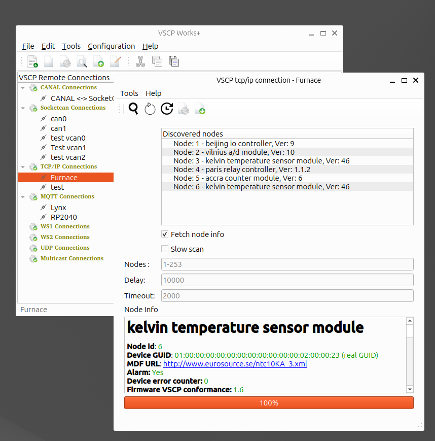
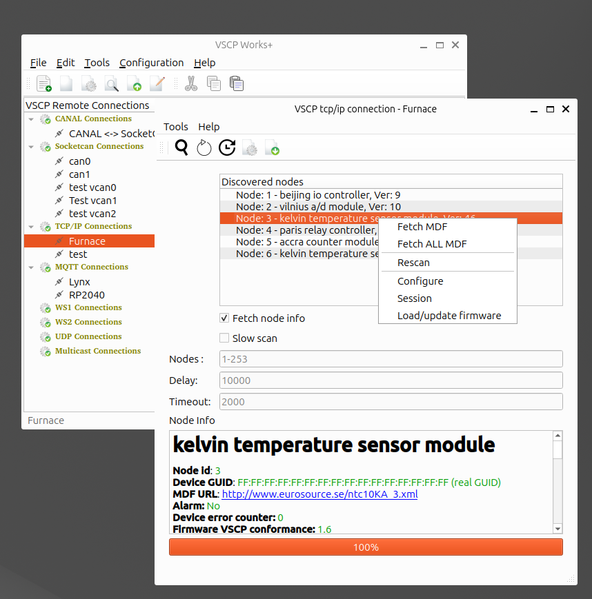

# Node scan 

## Description

The node scan window lets you search for nodes on a bus. This means you can discover nodes without waiting for them to announce themselves with heartbeats. Normally, the [MDF](https://grodansparadis.github.io/vscp-doc-spec/#/./vscp_module_description_file) of each node is downloaded when the node is found, so you get information about it right away. From the node scan window you can go directly to firmware update, session and node configuration.

Open the window by right-clicking a connection in the main window and selecting `Node scan`, or by selecting a connection and using `File/Scan for nodes...`. Press `F1` in the window to get to this page.

## Scanning

Press `Connect` (`Ctrl+C`) to connect to the interface and then `Scan` (`Ctrl+F`) to start the scan. The progress bar shows how far the scan has come and the info area shows how many nodes were found.

There are two scan methods.

### Normal scan

The default method. A single probe is sent, and all nodes that answer are listed. The `Response timeout` on the `Configuration` tab of the [settings](settings.md?id=configuration) decides how long to wait for answers. This is the fastest way to find nodes.

### Slow scan

Check `Slow scan` to probe nodes one at a time. This also works with nodes or interfaces that do not handle the normal scan well, but it takes longer.

| Field | Description |
| ----- | ----------- |
| Nodes | The node ids to probe. Enter a range (`1-253`), a list (`1,2,3`) or a combination of both (`1-10,20,30-40`). Numbers can be given in decimal or hex (`0x10`). |
| Delay | Delay between probes in microseconds. |
| Timeout | How long to wait for an answer from each node in milliseconds. |

The node ids that are probed are listed in the info area.

### Fetch node info

When `Fetch node info` is checked, the standard registers are read and the MDF is downloaded and parsed for every node that is found. The node entry in the list then shows the name of the device. If it is unchecked, only the node ids are listed, and you can fetch the information later.

## Discovered nodes

Click a node in the `Discovered nodes` list to show information about it in the info area. The information comes from the standard registers and the MDF of the node (manufacturer, model, firmware version, GUID, links to manuals, etc.). The MDF information must be fetched before device information can be shown.

Right-click a node to get the following options:

| Item | Description |
| ---- | ----------- |
| Fetch MDF | Read standard registers and download/parse the MDF for the selected node (`Ctrl+L`). |
| Fetch ALL MDF | Do the same for all discovered nodes (`Ctrl+A`). |
| Rescan | Scan again. |
| Configure | Open a [configuration window](config_window.md) for the selected node (`Ctrl+2`). |
| Session | Open a [session window](session_window.md) for the connection (`Ctrl+1`). |
| Load/update firmware | Start the [bootloader wizard](bootload_window.md) for the selected node. Node id and GUID are filled in for you. |

## Key shortcuts

| Key | Description |
| --- | --- |
| **F1** | Help |
| **Ctrl + C** | Connect |
| **Ctrl + F** | Scan |
| **Ctrl + L** | Load MDF for selected node |
| **Ctrl + A** | Load MDF for all nodes |
| **Ctrl + 1** | Open session window |
| **Ctrl + 2** | Open configuration window |
| **Ctrl + X** | Quit |
