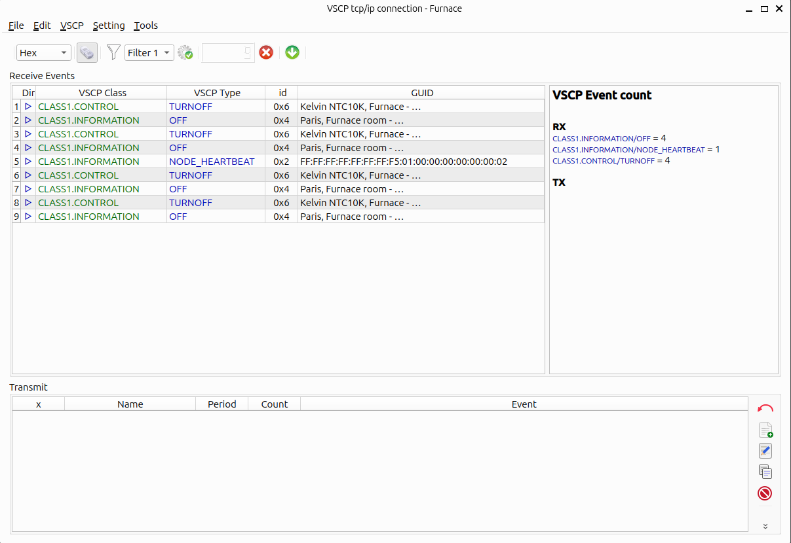
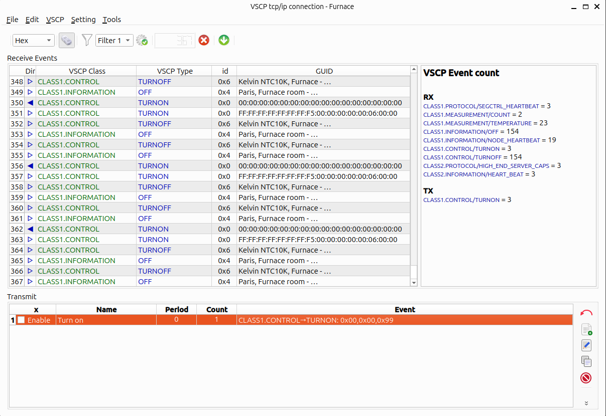
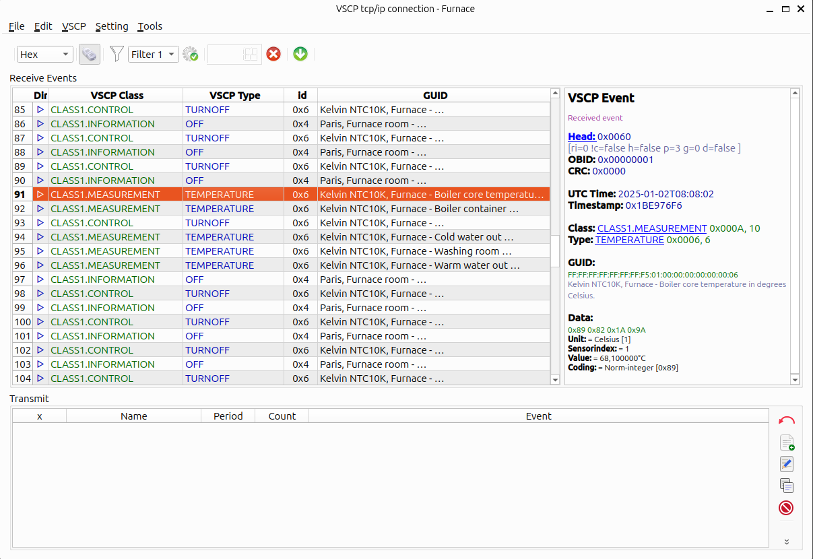
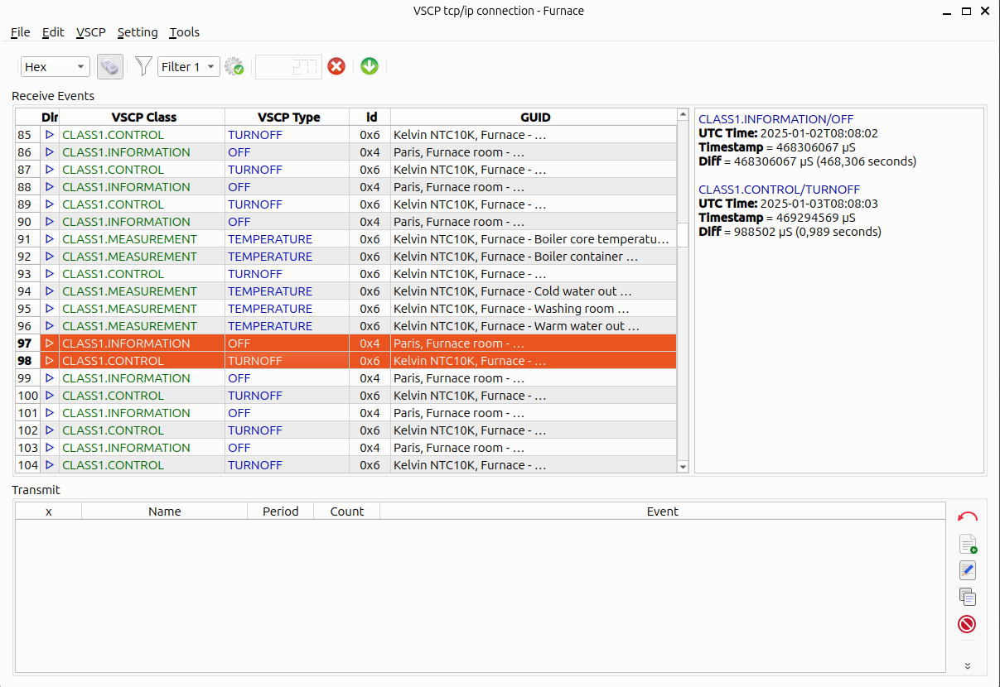
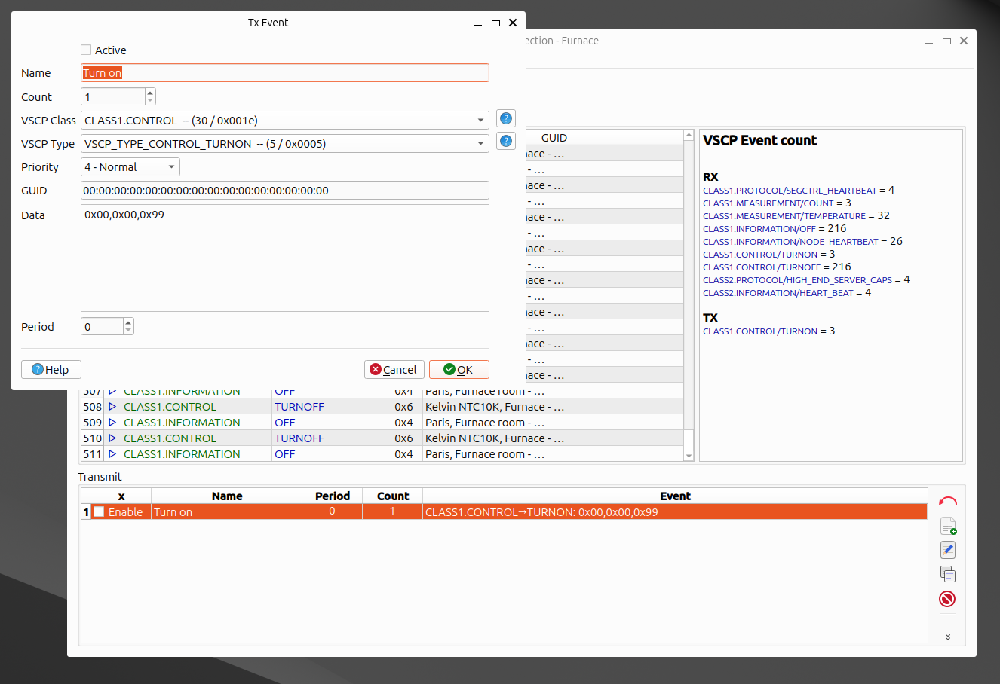

# Session Window

The session window is used to watch VSCP events on a connection in real time and to send events. Open it by right-clicking a connection in the main window and selecting `Session`, or by selecting a connection and using `File/Session window...`. Several session windows can be open at the same time, also for the same connection. Press `F1` in the window to get to this page.

The window has three parts:

- **Receive list** (top left) - Events received on the connection and events sent from this window.
- **Info area** (top right) - Details for the selected event(s), see below.
- **Transmit list** (bottom) - Events that you have prepared for sending.

## Toolbar

| Item | Description |
| ---- | ----------- |
| Numerical base | Select `Hex`, `Decimal`, `Octal` or `Binary` presentation of numbers. |
| Connect/disconnect | Connect to or disconnect from the remote host/interface (`Ctrl+O`). The icon shows the connection state. If `Connect automatically` is set in the [settings](settings.md?id=session-window) the window connects when it is opened. |
| Clear receive list | Remove all rows from the receive list. |
| Unselect all | Unselect all rows in the receive list. |

## Receive list

Each row shows direction (received or transmitted), VSCP class, VSCP type, node id and GUID. How class, type and GUID are presented is set in the [session window settings](settings.md?id=session-window). If the GUID is a [known GUID](settings.md?id=guid) its symbolic name can be shown instead of, or together with, the GUID.

The maximum number of rows kept in the list is set with `Max number of events` in the settings.

### Right-click menu

| Item | Description |
| ---- | ----------- |
| Clear selections | Unselect all rows. |
| Clear receive list | Remove all rows. |
| Copy RX event to clipboard | Copy the selected event to the clipboard. You are asked for the format: `STRING`, `JSON`, `XML` or `HTML`. |
| Copy RX event to TX | Add the selected event as a new row in the transmit list, ready to be sent again or modified. |
| Write events to file... | Save the receive list to an XML file. |
| Write marked events to file... | Save only rows marked with `Toggle row mark` to an XML file. |
| Load events from file... | Load events from an XML file into the receive list. |
| Set/edit GUID (sensor) | Open the [known GUID](settings.md?id=guid) dialog for the GUID of the selected event. If the GUID is unknown, a dialog for adding it is opened directly. |
| Open realtime measurement window... | Follow the measurement in the selected row in a [realtime measurement window](measurement_window.md). Only available for measurement events. |
| Add/Edit comment... | Add a comment to the selected row(s). Rows with a comment are marked with an icon and the comment is shown in the info area. |
| Remove comment | Remove the comment from the selected row(s). |
| Toggle row mark | Mark/unmark the selected row(s) with a special background color. |
| Toggle VSCP class mark | Mark/unmark the class of the selected row(s) with an icon. |
| Toggle VSCP type mark | Mark/unmark the type of the selected row(s) with an icon. |

Marks and comments are a convenient way to make notes while you debug a system. They are kept when the session is exported (see below).

## Info area

What is shown in the info area depends on how many rows are selected in the receive list.

- **No row selected** - Event counts. The number of received (`RX`) and transmitted (`TX`) events for each class/type combination.

  

- **One row selected** - Full details of the event: head and head bits, OBID, CRC, UTC time, timestamp, class and type (with links to the specification), GUID (and symbolic name), data, decoded measurement information (value, unit, sensor index) for measurement events and the comment, if any.

  

- **Several rows selected** - Time difference between the selected events. For each event class/type, UTC time and timestamp are listed together with the difference to the previous selected event in µs and seconds. This is useful to measure how often a node sends an event or how long it takes for a node to respond.

  

## Transmit list

The transmit list holds events you want to send. Each row has an enable checkbox, a name, a period, a count and the event.

| Button/menu item | Description |
| ---------------- | ----------- |
| Transmit / Send event | Send the selected row(s). Each event is sent `Count` times. The connection must be open. |
| Add / Add transmission row... | Define a new event to send. |
| Edit / Edit selected transmission row... | Edit the selected row. Double-clicking a row does the same. |
| Clone / Clone selected transmission row... | Make a copy of the selected row (`_copy` is appended to the name). |
| Delete / Delete selected transmission row... | Remove the selected row. |
| Save selected / Save SELECTED transmission rows... | Save the selected rows to an XML file. |
| Save all / Save ALL transmission rows... | Save all rows to an XML file. |
| Load / Load transmission rows... | Load rows from an XML file. |
| Copy TX event to clipboard | Copy the selected event to the clipboard as `STRING`, `JSON`, `XML` or `HTML`. |
| Clear selections... | Unselect all rows. |

The period value is stored with the row but events are currently sent when you press transmit.

If `Autosave/autoload tx rows` is set in the [settings](settings.md?id=session-window) the transmit list is saved when the window is closed and loaded again the next time a session window is opened for the same connection.

## Menus

### File

| Item | Description |
| ---- | ----------- |
| Load RX rows from file... | Load events from an XML file into the receive list. |
| Write RX rows to file... | Save the receive list to an XML file. |
| Import session from file... | Load a complete session (see below). |
| Export session to file... | Save a complete session (see below). |
| Load TX rows from file... | Load transmit rows from an XML file. |
| Write SELECTED TX rows to file... | Save selected transmit rows. |
| Write ALL TX rows to file... | Save all transmit rows. |
| Close window | Close the session window (`Ctrl+X`). |

#### Sessions

A session file is a JSON file (`format: vscpworks-session`) that holds:

- the connection definition,
- all receive rows including row/class/type marks, colors and comments,
- all transmit rows (enable, name, count, period and event).

Export a session to save the state of a debugging session, to continue later or to give it to someone else. Session files are by default stored in the `sessions` folder of the program data folder. A session file can also be imported as a new connection in the main window with `Edit/Import session data`.

### Edit

| Item | Shortcut | Description |
| ---- | -------- | ----------- |
| Copy RX event to clipboard | | See receive list above. |
| Copy TX event to clipboard | | See transmit list above. |
| Copy RX event to TX | | See receive list above. |
| Clear RX selections | `Alt+U` | Unselect all receive rows. |
| Clear RX list | `Ctrl+N` | Remove all receive rows. |
| Clear TX list | `Alt+2` | Remove all transmit rows. |
| Toggle RX row mark | `Alt+M` | Mark/unmark selected receive rows. |
| Toggle RX Class mark | `Alt+C` | Mark/unmark class of selected receive rows. |
| Toggle RX Type mark | `Alt+T` | Mark/unmark type of selected receive rows. |
| Add/Edit RX comment | | Add a comment to selected receive rows. |
| Remove RX comment | | Remove comments from selected receive rows. |

### Setting

`Settings...` opens the program [settings](settings.md).

### MQTT

This menu is only shown for MQTT connections.

| Item | Description |
| ---- | ----------- |
| MQTT subscribe topics... | Show the topics the connection subscribes to. |
| MQTT publish topics... | Show the topics the connection publishes to. |
| Clear MQTT retain topics... | Select publish topics and clear retained messages for them on the broker. |

### Tools

`Open realtime measurement window...` - Open a [realtime measurement window](measurement_window.md) for the selected measurement event.

## Key shortcuts

| Key | Description |
| --- | --- |
| **F1** | Open this help page |
| **Ctrl + O** | Connect/disconnect |
| **Ctrl + N** | Clear RX list |
| **Ctrl + X** | Close window |
| **Alt + 2** | Clear TX list |
| **Alt + C** | Toggle RX class mark |
| **Alt + M** | Toggle RX row mark |
| **Alt + T** | Toggle RX type mark |
| **Alt + U** | Clear RX selections |

## Filters

Session filters are defined with `Tools/Session filters...` in the main window. A filter is a named list of constraints. Each filter has a name, a description and an `Allow` setting (when unchecked the constraints define what is denied).

Use `New filter...`, `Edit filter...`, `Clone filter...` and `Delete filter...` (also available in the right-click menu) to manage filters, and `Load filters...`/`Save filters...` to load/save them.

In the filter editor, add constraints with `Add constraint...`. The following constraints are available:

| Constraint | Description |
| ---------- | ----------- |
| No constraint | Matches everything. |
| Must be received event / Must be transmitted event | Event direction. |
| Must be Level I event / Must be Level II event | Event level. |
| Must be measurement | Only measurement events. |
| Specific Class / Specific Type | VSCP class/type. |
| GUID | Origin GUID. |
| OBID | Interface id. |
| Priority | Event priority. |
| Timestamp / Date/Time | Event time. |
| Data size / Data value(s) | Size and content of the data part. |
| Sensor Index / Measurement Unit / Measurement Value / Measurement data coding | Measurement content. |
| Script | Script based constraint. |

Numerical constraints can be compared with `=`, `!=`, `<`, `<=`, `>` or `>=`.

?> The filter toolbar items in the session window are placeholders. Applying session filters to a session window is not yet implemented.

## Known GUIDs

See [GUID](settings.md?id=guid) in the settings documentation.

[For more information see](settings?id=guid)
