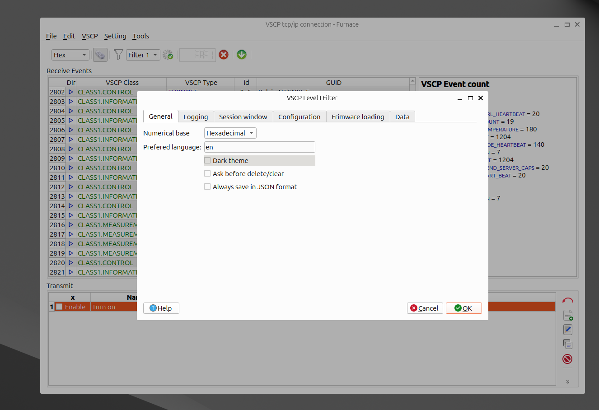
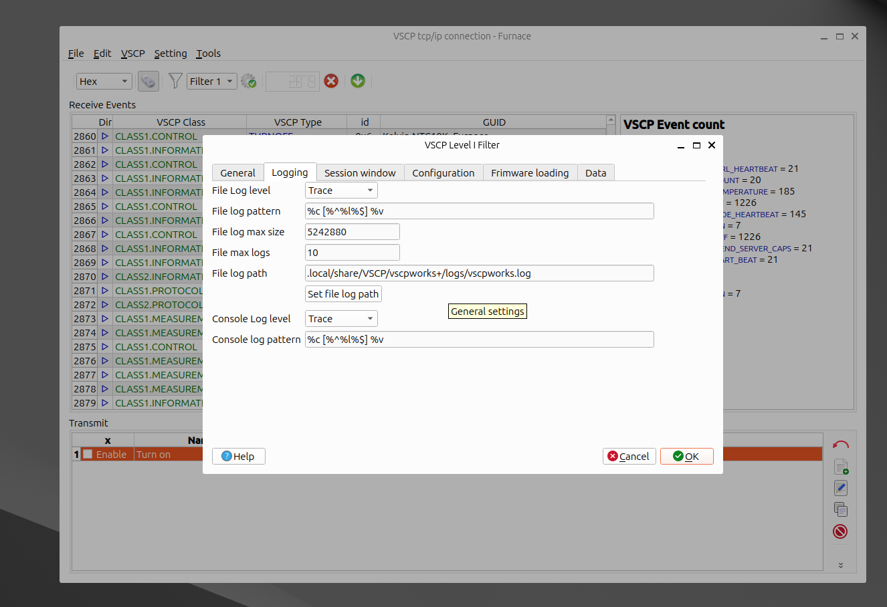
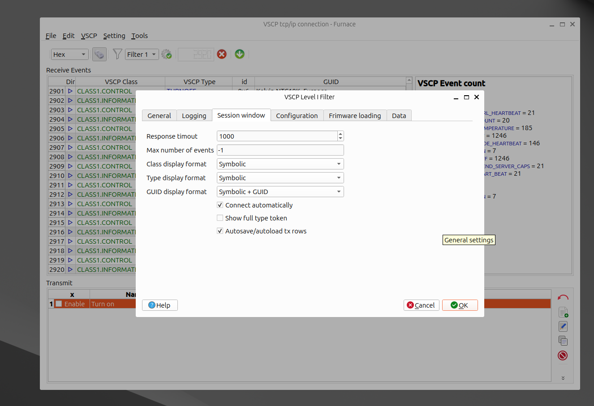
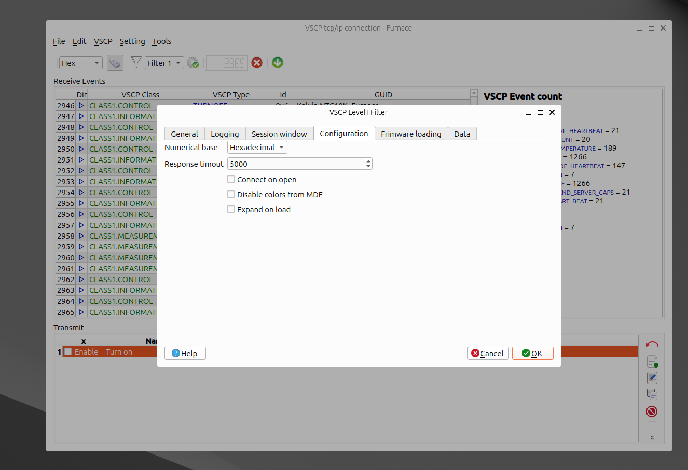
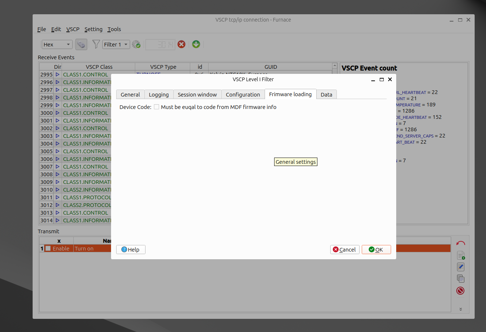
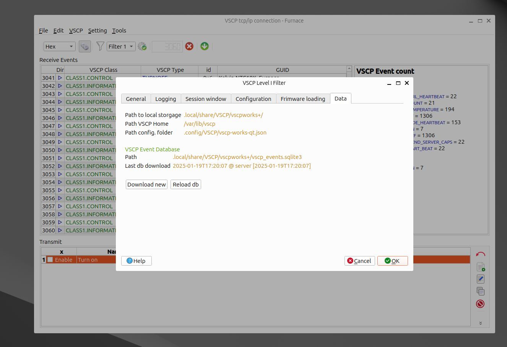
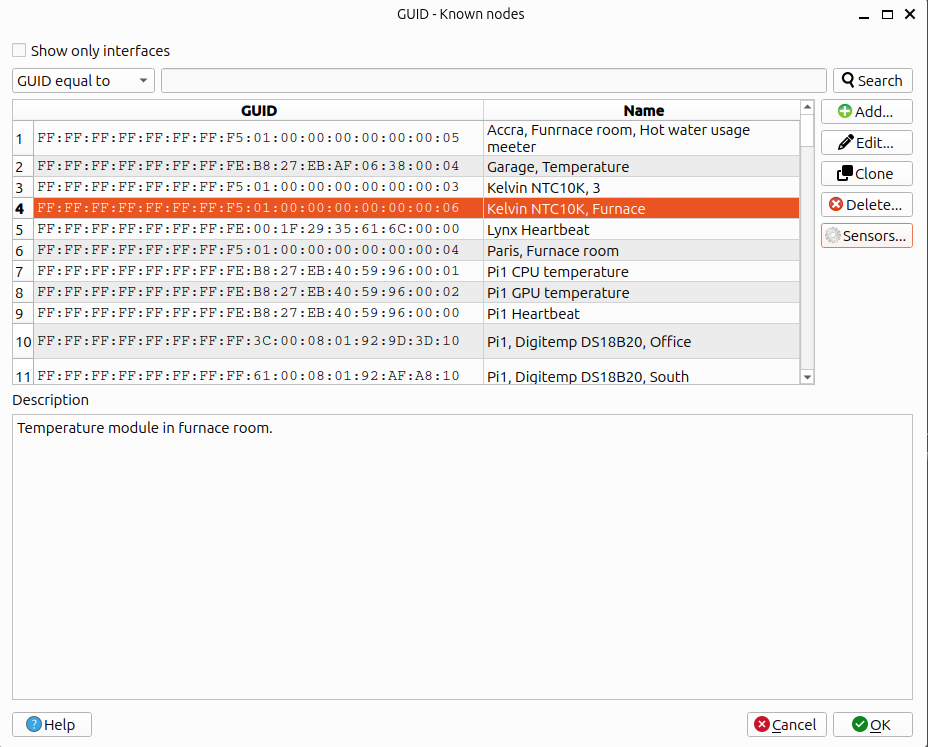
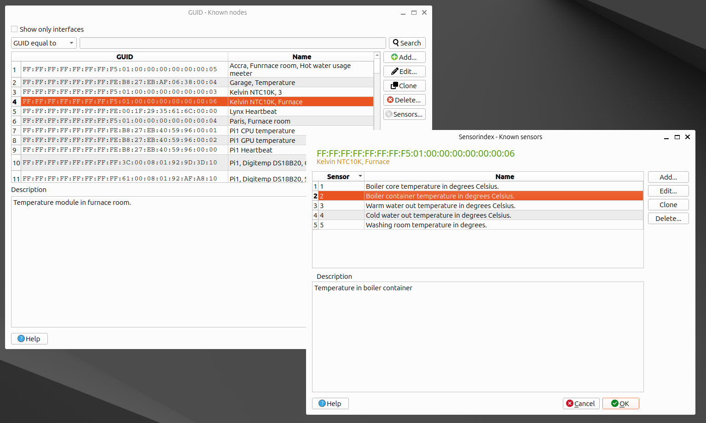

# Settings

Open the settings dialog with `Edit/Settings...` in the main window. Settings are stored in the [configuration file](configure.md) when the dialog is closed with `OK`. Press `F1` in the dialog to get to this page.

## General

| Setting | Description |
| ------- | ----------- |
| Numerical base | Default numerical base (hexadecimal, decimal, octal, binary) used to present numbers. |
| Ask before delete/clear | Ask for confirmation before items are deleted or lists are cleared. |
| Enable MDF autosave | Automatically save the MDF that is open in the [MDF editor](mdf.md) at a fixed interval. Only files that already have been saved/opened from disk are autosaved. |
| MDF autosave interval (s) | Interval in seconds between automatic saves (10 - 86400). |
| Use cumulative MDF backups | When an MDF is saved, keep timestamped backups (`file.bak.yyyyMMdd-HHmmss-zzz`) instead of replacing a single `file.bak`. |
| Max cumulative backups per file | Number of timestamped backups to keep for each MDF file. The oldest are deleted first. `0` keeps all backups. |
| Preferred language | Preferred language (ISO 639 code, for example `en`) for texts. |
| Dark theme | Use a dark color theme. *Currently not applied by the program.* |
| Always save in JSON format | Save register values from the [configuration window](config_window.md) in JSON format. |

## Logging

| Setting | Description |
| ------- | ----------- |
| File log level | Lowest severity written to the log file: `No logging`, `Critical`, `Errors`, `Warning`, `Information`, `Debug` or `Trace`. |
| File log pattern | Format of each line in the log file, as an [spdlog pattern](https://github.com/gabime/spdlog/wiki/3.-Custom-formatting). The default is `[vscpworks+] [%^%l%$] %v`. |
| File log max size | Maximum size of a log file, in bytes, before it is rotated. The default is 5242880 (5 MB). |
| File max logs | Number of rotated log files to keep. The default is 7. |
| File log path | Path to the log file. Press `Set file log path` to choose it. |
| Console log level | Lowest severity written to the console (the terminal the program was started from). Same choices as for the file log. |
| Console log pattern | Format of each line written to the console. |

Changes to the log settings take effect the next time VSCP Works + starts. See [logging](logging.md) for more about logging and the log viewer.

## Session window

| Setting | Description |
| ------- | ----------- |
| Max number of events | Maximum number of events kept in the receive list of a session window. `-1` means no limit. |
| Class display format | How the VSCP class is shown in the receive list: `Symbolic`, `Numerical in selected numerical base`, `Numerical hex/decimal` or `Symbolic + hex/decimal`. |
| Type display format | Same choices as for the class, used for the VSCP type. |
| GUID display format | How the GUID is shown: `GUID`, `Symbolic if possible`, `Symbolic + GUID` or `GUID + Symbolic`. Symbolic names come from [known GUIDs](settings.md?id=guid). |
| Connect automatically | Connect to the remote host as soon as a session window is opened. |
| Show full type token | Show the full type token (the `VSCP_TYPE_` prefix is not removed). |
| Autosave/autoload tx rows | Transmission rows are saved when a session window is closed and loaded again the next time a session window for the same connection is opened. |
| Response timeout | Timeout in milliseconds for responses to requests from the session window (500 - 10000). |

## Configuration

Settings for the [configuration window](config_window.md).

| Setting | Description |
| ------- | ----------- |
| Numerical base | Numerical base used to present register values. |
| Response timeout | Timeout in milliseconds for register read/write operations (500 - 10000). This timeout is also used by the node scan. |
| Connect on open | Connect to the remote host when the configuration window is opened. |
| Disable colors from MDF | Ignore foreground/background colors for registers defined in the MDF. |
| Expand on load | Expand the register tree when registers have been loaded. |

## Firmware loading

| Setting | Description |
| ------- | ----------- |
| Device Code | When checked, the *device firmware code* of the device must be equal to the code in the MDF firmware information before firmware is loaded. See [firmware update](bootload_window.md). It is strongly recommended to keep this checked. |

## Data

Shows the folders used by VSCP Works + (see [files and directory structure](files_and_directory_structure.md)):

| Item | Description |
| ---- | ----------- |
| Path to local storage | Main folder for files used by VSCP Works +. |
| Path VSCP Home | Location for general VSCP files. |
| Path config. folder | Folder for VSCP Works + configuration data. |
| VSCP Event Database - Path | Path to the VSCP events database (class/type/unit definitions). |
| Last db download | When the VSCP event database was last downloaded. |
| Download new | Download the latest version of the VSCP event database from the VSCP server. Do this when new classes/types have been added to the specification. |
| Reload db | Read the downloaded event database into memory. |

## GUID

GUID stands for **G**lobally **U**nique **ID**entifier. Every VSCP node and interface has a GUID. GUIDs are hard to remember, so VSCP Works + lets you give them symbolic names. These names are used in session windows (see `GUID display format` above) and other places where a GUID is shown.

Open the known GUID dialog with `Tools/Known GUID's` in the main window or by right-clicking an event in a session window and selecting `Set/edit GUID (sensor)` (the GUID of the event is then preselected or prepared for adding).

| Function | Description |
| -------- | ----------- |
| Add... | Add a new GUID with name and description. |
| Edit... | Edit the selected GUID. Double-clicking a row does the same. |
| Clone | Make a copy of the selected GUID. |
| Delete... | Delete the selected GUID. |
| Sensors... | Edit [sensor indexes](settings.md?id=sensor-index) for the selected GUID. |
| Search | Search for the text in the search field. Select `GUID equal to`, `GUID starts with`, `GUID contains`, `Name equal to`, `Name starts with` or `Name contains`. Pressing `Search` again finds the next match after the selected row. |
| Show only interfaces | Only list interface GUIDs (GUIDs where the two least significant bytes are zero). |

The same functions are available by right-clicking in the list. Known GUIDs are stored in the VSCP Works + database (`vscpworks.sqlite3`). A [demo database](demo.md?id=demo-guid-and-sensor-database) is available.

## Sensor Index

A sensor index identifies a particular sensor on a node that has several sensors connected. It is a number from 0 to 7 for Level I events and from 0 to 255 for Level II events.

Select a GUID in the known GUID dialog and press `Sensors...` to give the sensors of that node names and descriptions. Use `Add...`, `Edit...`, `Clone` and `Delete...` (or right-click in the list) to manage the sensors. The sensor name is shown together with measurement events from the node in the session window.
